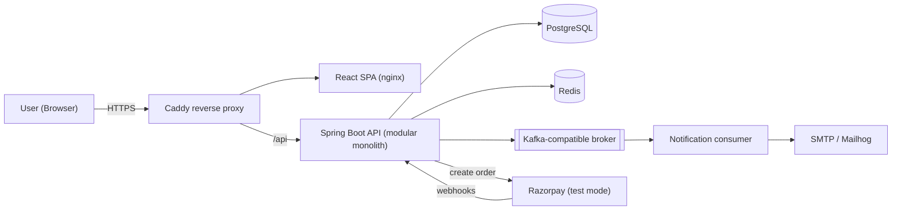

# SplitLedger

> A ledger-first expense-splitting and settlement platform (Splitwise-style) with Razorpay test-mode payments.
> Built as a production-style full-stack project: Java/Spring Boot backend, React frontend, Docker, CI/CD, cloud deployment, Agile delivery.

**Rename freely.** "SplitLedger" is a working title.

---

## 1. Why this project exists

Most Splitwise clones are CRUD apps. SplitLedger treats **money correctness** as the product:

- Money is stored as integer **paise** (never floats).
- Every balance change is an **immutable double-entry ledger posting**; corrections are reversals, never edits.
- Settlements follow an explicit **state machine** and are **idempotent** (retries and duplicate webhooks never double-count).
- Payments go through a **PaymentProvider port** with Razorpay (test mode), UPI intent, cash and a sandbox provider as adapters.

> **Scope disclaimer.** SplitLedger is a **publicly reachable demo**, and **no real money moves
> anywhere in it.**
>
> Anyone can sign up and use it. Settlement runs through **Razorpay test mode**, cash, or a sandbox
> provider — real API calls, real signature verification, real idempotency, simulated funds. The
> expenses, splits, ledger and balances are computed for real; the amounts are whatever people type
> to try it out.
>
> `UPI_INTENT` is built and tested but **disabled in the deployed instance**: a `upi://pay` link
> opens a real UPI app against a real payee, so it is the one method that could move real money
> against fictional data. Actual user-to-user fund routing would need Razorpay Route/Payouts, business
> KYC and a regulatory posture that is deliberately out of scope. Full reasoning:
> [`docs/RUNNING_LIVE.md`](docs/RUNNING_LIVE.md) §2.

---

## 2. Features

### MVP
| Area | Feature |
|---|---|
| Identity | Register, login, JWT access + refresh rotation, logout |
| Groups | Create groups, invite by email with explicit accept, add/remove members, role-based access |
| Expenses | Equal / exact / percentage / shares splits, correct paise rounding, edit (replace) and void |
| Balances | Net balance per member, pairwise debts, simplified "who pays whom" |
| Settlements | Razorpay test-mode checkout, cash, sandbox provider; UPI intent link built but disabled in the deployed instance |
| Reliability | Idempotency keys, webhook signature verification and de-duplication, concurrency-safe writes |
| Events | Transactional outbox, Kafka-compatible broker, notification consumer |
| Ops | Redis caching + rate limiting, metrics, structured logs, load-test report |
| Delivery | Dockerised, GitHub Actions CI/CD, deployed to AWS with HTTPS |

### Stretch
Natural-language expense entry (AI draft, human confirms), UPI QR codes, recurring expenses, receipt uploads, Google OAuth login, Terraform + ECS Fargate, PWA.

---

## 3. Architecture at a glance



Details: [`docs/HLD.md`](docs/HLD.md) and [`docs/LLD.md`](docs/LLD.md).

---

## 4. Tech stack

| Layer | Choice |
|---|---|
| Backend | Java 21, Spring Boot 3.x, Spring Security, Spring Data JPA/Hibernate, Flyway |
| Data | PostgreSQL 16, Redis 7 |
| Messaging | Kafka API (Redpanda locally/VM), transactional outbox |
| Frontend | React 18, TypeScript, Vite, TanStack Query, React Router, Tailwind CSS, React Hook Form + Zod |
| Payments | Razorpay Java SDK + Checkout.js (test mode), UPI intent deep links |
| Testing | JUnit 5, Mockito, jqwik (property-based), ArchUnit, Testcontainers (**CI only**), `EmbeddedKafkaBroker` + GreenMail (in-JVM), Vitest, React Testing Library, Playwright, k6 |
| DevOps | Docker + Compose (**CI and the VM only, never local**), GitHub Actions, GHCR, AWS EC2 + Caddy (Terraform/ECS as stretch) |
| Observability | Spring Actuator, Micrometer, Prometheus, Grafana, JSON logs with correlation IDs |

---

## 5. Repository layout

```
splitledger/
├── backend/                  # Spring Boot app (Maven)
│   └── src/main/java/com/splitledger/
│       ├── identity/  group/  expense/  ledger/
│       ├── settlement/  payment/  notification/
│       └── common/
├── frontend/                 # React + Vite + TypeScript
├── infra/
│   ├── docker-compose.yml        # local dev stack
│   ├── docker-compose.prod.yml   # VM deployment
│   ├── caddy/Caddyfile
│   ├── prometheus/prometheus.yml
│   └── k6/                       # load tests
├── scripts/                  # smoke test, rollback, simulate-webhook
├── docs/                     # HLD, LLD, CI/CD, Agile, Roadmap, review, sprint plan, ADRs
└── .github/
    ├── workflows/pipeline.yml
    ├── ISSUE_TEMPLATE/
    └── pull_request_template.md
```

---

## 6. Quick start (local)

> **No Docker and no local database are used for development** (ADR-012). The JVM and Vite run
> directly on your machine; Postgres, Redis and SMTP are managed free-tier services. Docker
> appears only in CI (Testcontainers, image builds) and on the deployment VM.

Prerequisites: **JDK 21** (Temurin), **Node** as pinned in `.nvmrc`, `git`, `gh`.
No system Maven needed -- use the wrapper, `./mvnw`.

One-time setup:
1. Create a free managed **Postgres 16** (Neon), **Redis** (Upstash) and **SMTP sandbox** (Mailtrap).
2. `cp .env.example .env`, then fill in the connection strings and your Razorpay **test** keys.
3. Run `./scripts/check-env.sh` to prove DB, Redis and SMTP are reachable before you start.

```bash
git clone https://github.com/<you>/splitledger.git
cd splitledger
cp .env.example .env
./scripts/check-env.sh

# backend (Flyway migrates the managed dev database on startup)
cd backend && ./mvnw spring-boot:run

# frontend (new terminal)
cd frontend && nvm use && npm ci && npm run dev
```

| Service | Where |
|---|---|
| Frontend | http://localhost:5173 |
| API | http://localhost:8080/api/v1 |
| Swagger UI | http://localhost:8080/swagger-ui.html (dev only; disabled in `prod`) |
| Database / cache | your Neon / Upstash dashboards |
| Captured dev email | your Mailtrap inbox |
| Metrics dashboard | Grafana Cloud (free tier) |

```bash
cd backend && ./mvnw test                 # unit + jqwik property tests, fully offline
cd backend && ./mvnw verify -PcloudIT     # integration suite against the managed dev database
```
The Testcontainers suite runs **in CI only**, where a Docker daemon exists. A story is Done when
**CI** is green; a passing local run is necessary but not sufficient.

### Environment variables (`.env.example`)
```
# --- database (managed dev instance -- never point this at production) ---
DB_URL=jdbc:postgresql://<host>/<db>?sslmode=require
DB_USER=splitledger
DB_PASSWORD=
# --- cache ---
REDIS_URL=rediss://default:<token>@<host>:6379
# --- broker (Phase 5; blank selects the in-process LocalEventBus) ---
KAFKA_BOOTSTRAP=
KAFKA_SECURITY_PROTOCOL=SASL_SSL
KAFKA_SASL_JAAS_CONFIG=
# --- mail ---
SMTP_HOST=sandbox.smtp.mailtrap.io
SMTP_PORT=2525
SMTP_USER=
SMTP_PASSWORD=
MAIL_FROM=no-reply@splitledger.local
# --- auth ---
JWT_SECRET=change-me-to-a-long-random-string
# --- payments (TEST MODE ONLY) ---
RAZORPAY_KEY_ID=rzp_test_xxxxx
RAZORPAY_KEY_SECRET=
RAZORPAY_WEBHOOK_SECRET=
# --- app ---
APP_BASE_URL=http://localhost:5173
CORS_ALLOWED_ORIGINS=http://localhost:5173
SANDBOX_AUTOCONFIRM_DELAY=PT5S
```
On the deployment VM the same file additionally carries `POSTGRES_PASSWORD` (initialises the
Postgres container; set it equal to `DB_PASSWORD`) and `OWNER` (your lowercase GHCR owner, used
by `docker-compose.prod.yml`).

Never commit real secrets. Test keys only.

---

## 7. Documentation index

| Doc | Contents |
|---|---|
| [`docs/HLD.md`](docs/HLD.md) | Requirements, context, containers, flows, tech choices, NFRs, ADRs |
| [`docs/LLD.md`](docs/LLD.md) | Class design, ER + DDL, algorithms, state machine, APIs, idempotency, concurrency, frontend design |
| [`docs/CICD_DOCKER_CLOUD.md`](docs/CICD_DOCKER_CLOUD.md) | Branching, pipelines (YAML), Dockerfiles, Compose, AWS deployment, testing and quality gates |
| [`docs/AGILE.md`](docs/AGILE.md) | Solo-Scrum process, board, Definition of Ready/Done, templates |
| [`docs/SPRINT_PLAN.md`](docs/SPRINT_PLAN.md) | **The active plan:** 10 sprints at 13 points, with exit criteria and both cut lines |
| [`docs/adr/`](docs/adr/README.md) | All 15 architecture decision records, with context, alternatives and consequences |
| [`docs/ACCOUNTS_AND_ACCESS.md`](docs/ACCOUNTS_AND_ACCESS.md) | Using a personal GitHub account alongside work on one machine, why GHCR means no Docker Hub account is needed, and where each credential belongs |
| [`docs/RUNNING_LIVE.md`](docs/RUNNING_LIVE.md) | Keeping the public demo live as one person: what "demo" means precisely, why UPI intent is the risky method, demo framing, the guest tour, hosting and real cost, alert policy |
| [`docs/REVIEW_FINDINGS.md`](docs/REVIEW_FINDINGS.md) | Design review: blockers, corrections, expense-splitter do's and don'ts, the no-local-Docker setup |
| [`docs/ROADMAP.md`](docs/ROADMAP.md) | Superseded by `SPRINT_PLAN.md`; kept for the story catalogue and interview story bank |

---

## 8. Project status

Plan of record: [`docs/SPRINT_PLAN.md`](docs/SPRINT_PLAN.md).
Portfolio cut line = S0 to S7. Public-demo cut line = that plus S9. S8 is the compressible one.
Deployment is S6, deliberately *before* the gateway sprint: a stable public HTTPS URL replaces the
webhook tunnel. The app goes live with registration switched off and opens to the public in S9.

| Sprint | Goal | Status |
|---|---|---|
| S0 | Foundations & decisions | ⬜ |
| S1 | Identity | ⬜ |
| S2 | Groups, membership & invites | ⬜ |
| S3 | Money core (splits + ledger) | ⬜ |
| S4 | Balances, corrections & activity | ⬜ |
| S5 | Settlements (no gateway) | ⬜ |
| S6 | Deploy it, door shut | ⬜ |
| S7 | Razorpay test mode | ⬜ |
| S8 | Events, cache & performance | ⬜ |
| S9 | Open it to the public | ⬜ |

---

## 9. Results (fill in only with measured numbers)

| Metric | Value | How measured |
|---|---|---|
| Load test throughput | `<X> req/s` | k6 script `infra/k6/...` |
| p95 latency (balances, cached vs uncached) | `<X> ms → <Y> ms` | k6, Grafana screenshot |
| Concurrent settlement test | `<N> threads, 0 balance drift` | integration test |
| Test coverage (domain + application) | `<X>%` | JaCoCo in CI |
| Live demo | `<url>` | |

### Resume bullets (template — replace the placeholders with real results)
- Built SplitLedger, a full-stack expense-settlement platform (Java 21, Spring Boot, PostgreSQL, Redis, Kafka, React), modelling balances as an immutable double-entry ledger in integer paise.
- Implemented idempotent settlement APIs and Razorpay (test-mode) webhook processing with signature verification and de-duplication; verified `<0>` balance drift across `<N>` concurrent transactions.
- Reduced p95 balance-API latency from `<X>` ms to `<Y>` ms with Redis caching, measured with k6 at `<N>` req/s.
- Shipped via GitHub Actions CI/CD to AWS using Docker, with `<X>%` automated test coverage and automatic rollback on failed smoke tests.

---

## 10. License
MIT (or your choice).
