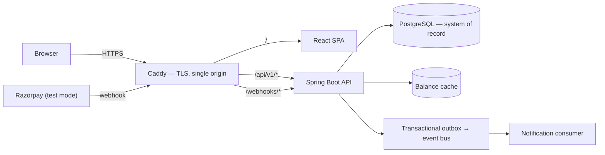

# SplitLedger

[](https://github.com/arpitarajeevmishra/splitledger/actions/workflows/pipeline.yml)
[](LICENSE)


Expense splitting built on an immutable double-entry ledger. Shared expenses are recorded as
balanced ledger postings in integer paise, so every balance is auditable, every correction is a
reversal rather than an edit, and arithmetic cannot drift.

> **No real money moves anywhere in this application.** Settlement runs through Razorpay **test
> mode**, cash, or a sandbox provider — real API calls, real signature verification, real
> idempotency, simulated funds. UPI intent links are implemented and tested but disabled in the
> deployed instance, because they are the one method that could reach a real bank account. Routing
> funds between users would require Razorpay Route/Payouts, business KYC and a regulatory posture
> that is deliberately out of scope.

---

## Why

Most expense splitters are CRUD applications with a balance column. SplitLedger treats **money
correctness as the product**:

- **Integer paise end to end.** `BIGINT` in PostgreSQL, `long` in Java, integers over the wire,
  string-based parsing in the browser. No floating point touches money at any layer.
- **Immutable ledger.** Postings are append-only and every transaction sums to exactly zero. Voiding
  an expense inserts a reversal; editing is void-plus-replace. History is never rewritten, so any
  balance can be explained.
- **Exact splits.** Equal, exact, percentage and share splits all resolve through largest-remainder
  allocation with a deterministic tie-break, so allocations sum to the total to the paisa.
- **Idempotent money endpoints.** Client retries, duplicate webhooks and late gateway events cannot
  double-count. Idempotency records live in PostgreSQL, not the cache, because losing one would
  permit a double charge.
- **Deliberate concurrency.** A per-group row lock serialises balance-affecting writes within a
  group while unrelated groups proceed in parallel; expense edits use optimistic versioning.
- **Reconciliation.** A nightly job derives balances two independent ways and exports a drift
  metric that must always be zero.

---

## Architecture

A modular monolith with one additional runtime role. Module boundaries are enforced by ArchUnit
tests rather than convention — no cycles, controllers never reach repositories, and the ledger
knows nothing about expenses or settlements.



The SPA and API share one origin. That is load-bearing rather than cosmetic: it is what allows the
refresh token to be a `SameSite=Strict` cookie, and why the frontend calls relative `/api/v1` paths
with no base-URL environment variable.

Balances are derived two independent ways: **net** balances come from the ledger postings and are
the authorisation model, while **pairwise** figures are derived from the source tables and drive
what the UI shows. A nightly job recomputes both and exports a drift metric, so a disagreement
between them is an alert rather than a surprise.

---

## Tech stack

| Layer | Choice |
|---|---|
| Backend | Java 27, Spring Boot 4.1, Spring Security 7, Spring Data JPA, Flyway |
| Data | PostgreSQL 16, Redis (optional; in-process cache by default) |
| Messaging | Transactional outbox behind a publisher interface — in-process bus deployed, Kafka adapter tested in CI |
| Frontend | React 19, TypeScript (strict), Vite, TanStack Query, React Router, Tailwind CSS v4, React Hook Form + Zod |
| Payments | Razorpay Java SDK + Checkout.js (test mode), UPI intent deep links |
| Testing | JUnit 5, jqwik (property-based), ArchUnit, Testcontainers, Vitest, React Testing Library, Playwright, k6 |
| Delivery | GitHub Actions, GHCR, Docker, Caddy |
| Observability | Actuator, Micrometer, Prometheus, structured JSON logs with correlation ids |

---

## Getting started

### Prerequisites

| Tool | Notes |
|---|---|
| **JDK 27** | Required. Any distribution |
| **Node** | Version pinned in `.nvmrc` |
| `git`, `gh` | `gh` is used for repository and board automation |

No system Maven is needed — the project uses the Maven Wrapper. **No Docker and no local database
are required for development**: the application runs against a managed PostgreSQL instance, and the
container-based integration suite runs in CI, which is where a Docker daemon exists.

### Configuration

```bash
git clone https://github.com/arpitarajeevmishra/splitledger.git
cd splitledger
cp .env.example .env     # fill in a PostgreSQL URL and a JWT secret
./scripts/check-env.sh   # verifies required variables and store reachability
```

`.env.example` documents every variable. Secrets never enter the repository; `.gitignore` excludes
`.env` and all key material.

### Running

```bash
cd backend && ./mvnw spring-boot:run
```

```bash
cd frontend && npm ci && npm run dev
```

| Service | URL |
|---|---|
| Frontend | http://localhost:5173 |
| API | http://localhost:8080/api/v1 |
| API docs | http://localhost:8080/swagger-ui.html (disabled in the `prod` profile) |

### Testing

```bash
cd backend && ./mvnw test
```

Unit and property-based tests; fully offline, no Docker required.

```bash
cd backend && ./mvnw verify
```

Adds the Testcontainers integration suite, which requires a Docker daemon and therefore runs in CI.

```bash
cd frontend && npm run typecheck && npm run lint && npm run test
```

A change is complete when **CI** is green — a passing local run is necessary but not sufficient,
since the integration suite does not run locally.

---

## Project structure

```
splitledger/
├── backend/            Spring Boot application (Maven)
│   └── src/main/java/com/splitledger/
│       ├── identity/  group/  expense/  ledger/
│       ├── settlement/  payment/  notification/  outbox/
│       └── common/     money, errors, idempotency, security, web
├── frontend/           React + Vite + TypeScript
├── infra/              Compose files, Caddy, Prometheus, k6
├── deploy/             The production stack: Caddy, compose, server env template, runbook
└── scripts/            Environment checks, repository bootstrap, operational scripts
```

---

## Deployment

The deployed shape is one small Linux box: Caddy terminating TLS in front of the SPA and the API,
with PostgreSQL managed and off the host. Images are built once by CI, published to GHCR tagged by
commit SHA, and pulled by the host — nothing is built on a developer machine or on the server.

```bash
./scripts/deploy.sh ubuntu@<host>            # deploy HEAD
```

```bash
./scripts/deploy.sh ubuntu@<host> <sha>      # roll back to any published commit
```

Because images are tagged by commit and the host holds no state, a rollback is a restart on a
cached image rather than a rebuild, and destroying the box costs a redeploy and nothing else.

Both images are published for `linux/amd64` and `linux/arm64`, so the host can be an ARM instance.
**[deploy/README.md](deploy/README.md)** walks through a deployment on Oracle Cloud's
Always Free tier, which runs this stack at no ongoing cost — including the current free-tier limits,
the two firewalls that have to agree, and the idle-reclamation rule worth sizing around.

Scale-to-zero platforms are a poor fit regardless of price: the settlement expiry sweeper, the
provider payment poller, the idempotency purge and the nightly reconciliation job all run
`@Scheduled` inside the API process, and a host that sleeps when idle does not run them.

---

## Design decisions

Architectural choices are recorded as ADRs, each with the context, the alternatives considered and
the consequences accepted. The four that shape the system most:

- **A modular monolith, not microservices.** Splitting expenses, the ledger and settlements across
  services would turn one atomic transaction into a saga with compensating actions — a harder
  correctness problem than the one being solved. The boundaries still exist and are enforced by
  ArchUnit tests, so they are verifiable rather than aspirational.
- **Settlements are validated against net balances, not pairwise debt.** Debt simplification
  deliberately produces transfers between people with no direct debt — A owes B, B owes C, so A
  pays C. Validating pairwise would reject every suggestion the application makes.
- **The access token lives in memory; the refresh token is an `httpOnly`, `SameSite=Strict`
  cookie** scoped to the refresh path and rotated on every use. Presenting a used token revokes the
  whole chain, since reuse means the value leaked.
- **The deployed runtime drops the broker and the distributed cache** in favour of in-process
  implementations behind the same interfaces. The guarantees live in the outbox table and a
  consumer-side de-duplication table, not in the broker, so this costs nothing observable at this
  scale — and switching back is configuration, not redesign.

---

## Development workflow

Trunk-based development: `main` is always deployable, changes arrive as short-lived branches and
squash-merged pull requests, and commits follow Conventional Commits. Every pull request must pass
build, lint, type checks, unit and integration tests, and a blocking secret scan. Database
migrations are forward-only and backward-compatible, so rolling back the application never meets a
schema it cannot read.

A change is not done until CI is green, the acceptance criteria are demonstrated, and any
money-affecting code carries a test that would fail if its invariant broke.

---

## License

[MIT](LICENSE)
