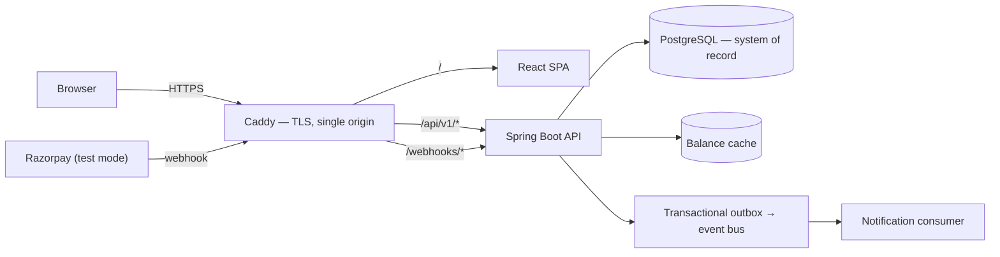

# SplitLedger

[](https://github.com/arpitarajeevmishra/splitledger/actions/workflows/pipeline.yml)
[](LICENSE)


Expense splitting built on an immutable double-entry ledger. Shared expenses are recorded as
balanced ledger postings in integer paise, so every balance is auditable, every correction is a
reversal rather than an edit, and arithmetic cannot drift.

> **No real money moves anywhere in this application.** Settlement runs through Razorpay **test
> mode**, cash, or a sandbox provider — real API calls, real signature verification, real
> idempotency, simulated funds. UPI intent links are implemented and tested but disabled in the
> deployed instance, because they are the one method that could reach a real bank account. Routing
> funds between users would require Razorpay Route/Payouts, business KYC and a regulatory posture
> that is deliberately out of scope.

---

## Why

Most expense splitters are CRUD applications with a balance column. SplitLedger treats **money
correctness as the product**:

- **Integer paise end to end.** `BIGINT` in PostgreSQL, `long` in Java, integers over the wire,
  string-based parsing in the browser. No floating point touches money at any layer.
- **Immutable ledger.** Postings are append-only and every transaction sums to exactly zero. Voiding
  an expense inserts a reversal; editing is void-plus-replace. History is never rewritten, so any
  balance can be explained.
- **Exact splits.** Equal, exact, percentage and share splits all resolve through largest-remainder
  allocation with a deterministic tie-break, so allocations sum to the total to the paisa.
- **Idempotent money endpoints.** Client retries, duplicate webhooks and late gateway events cannot
  double-count. Idempotency records live in PostgreSQL, not the cache, because losing one would
  permit a double charge.
- **Deliberate concurrency.** A per-group row lock serialises balance-affecting writes within a
  group while unrelated groups proceed in parallel; expense edits use optimistic versioning.
- **Reconciliation.** A nightly job derives balances two independent ways and exports a drift
  metric that must always be zero.

---

## Architecture

A modular monolith with one additional runtime role. Module boundaries are enforced by ArchUnit
tests rather than convention — no cycles, controllers never reach repositories, and the ledger
knows nothing about expenses or settlements.



The SPA and API share one origin. That is load-bearing rather than cosmetic: it is what allows the
refresh token to be a `SameSite=Strict` cookie, and why the frontend calls relative `/api/v1` paths
with no base-URL environment variable.

Requirements, container and module views, and the non-functional targets are in
[`docs/HLD.md`](docs/HLD.md). Class design, DDL, algorithms, the settlement state machine and the
API contract are in [`docs/LLD.md`](docs/LLD.md). For the path a request actually takes end to end,
see [`docs/flow.md`](docs/flow.md).

---

## Tech stack

| Layer | Choice |
|---|---|
| Backend | Java 27, Spring Boot 4.1, Spring Security 7, Spring Data JPA, Flyway |
| Data | PostgreSQL 16, Redis (optional; in-process cache by default) |
| Messaging | Transactional outbox behind a publisher interface — in-process bus deployed, Kafka adapter tested in CI |
| Frontend | React 19, TypeScript (strict), Vite, TanStack Query, React Router, Tailwind CSS v4, React Hook Form + Zod |
| Payments | Razorpay Java SDK + Checkout.js (test mode), UPI intent deep links |
| Testing | JUnit 5, jqwik (property-based), ArchUnit, Testcontainers, Vitest, React Testing Library, Playwright, k6 |
| Delivery | GitHub Actions, GHCR, Docker, Caddy |
| Observability | Actuator, Micrometer, Prometheus, structured JSON logs with correlation ids |

---

## Getting started

### Prerequisites

| Tool | Notes |
|---|---|
| **JDK 27** | Required. Any distribution |
| **Node** | Version pinned in `.nvmrc` |
| `git`, `gh` | `gh` is used for repository and board automation |

No system Maven is needed — the project uses the Maven Wrapper. **No Docker and no local database
are required for development**: the application runs directly against managed Postgres, and
container-based integration tests run in CI. See
[`docs/adr/012-no-local-database-or-docker.md`](docs/adr/012-no-local-database-or-docker.md).

### Configuration

```bash
git clone https://github.com/arpitarajeevmishra/splitledger.git
cd splitledger
cp .env.example .env     # fill in a PostgreSQL URL and a JWT secret
./scripts/check-env.sh   # verifies required variables and store reachability
```

`.env.example` documents every variable. Secrets never enter the repository; `.gitignore` excludes
`.env` and all key material.

### Running

```bash
cd backend && ./mvnw spring-boot:run
```

```bash
cd frontend && npm ci && npm run dev
```

| Service | URL |
|---|---|
| Frontend | http://localhost:5173 |
| API | http://localhost:8080/api/v1 |
| API docs | http://localhost:8080/swagger-ui.html (disabled in the `prod` profile) |

### Testing

```bash
cd backend && ./mvnw test
```

Unit and property-based tests; fully offline, no Docker required.

```bash
cd backend && ./mvnw verify
```

Adds the Testcontainers integration suite, which requires a Docker daemon and therefore runs in CI.

```bash
cd frontend && npm run typecheck && npm run lint && npm run test
```

A change is complete when **CI** is green — a passing local run is necessary but not sufficient,
since the integration suite does not run locally.

---

## Project structure

```
splitledger/
├── backend/            Spring Boot application (Maven)
│   └── src/main/java/com/splitledger/
│       ├── identity/  group/  expense/  ledger/
│       ├── settlement/  payment/  notification/  outbox/
│       └── common/     money, errors, idempotency, security, web
├── frontend/           React + Vite + TypeScript
├── infra/              Compose files, Caddy, Prometheus, k6
├── scripts/            Environment checks, repository bootstrap, operational scripts
└── docs/               Design, decisions and process
```

---

## Design decisions

Architectural choices are recorded as ADRs in [`docs/adr/`](docs/adr/README.md) — each with the
context, the alternatives considered, and the consequences accepted. The ones that shape the system
most: settlements validate against **net** balances rather than pairwise debt so that debt
simplification is payable at all; the access token lives in memory while the refresh token is an
`httpOnly` cookie; and the deployed runtime drops the broker and cache in favour of in-process
implementations behind the same interfaces.

Smaller day-to-day decisions — the ones that do not warrant an ADR but still cost thought — are
logged chronologically in [`docs/decision.md`](docs/decision.md), each with the trade-off that was
knowingly accepted.

---

## Development workflow

Trunk-based development: `main` is always deployable, changes arrive as short-lived branches and
squash-merged pull requests, and commits follow Conventional Commits. Every pull request must pass
build, lint, type checks, unit and integration tests, and a blocking secret scan. Database
migrations are forward-only and backward-compatible, so rolling back the application never meets a
schema it cannot read.

Process, the Definition of Ready and the Definition of Done are in [`docs/AGILE.md`](docs/AGILE.md).
Delivery, container and deployment detail is in
[`docs/CICD_DOCKER_CLOUD.md`](docs/CICD_DOCKER_CLOUD.md).

---

## License

[MIT](LICENSE)
