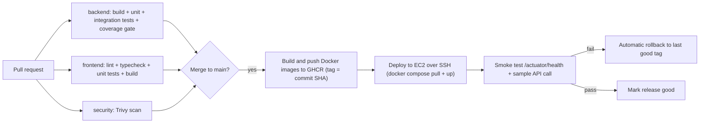

# CI/CD, Docker, Cloud and Quality Gates

> Pin all third-party action and image versions to the current release when you implement this. Versions below are examples.
>
> **ADR-012 applies throughout this document.** There is no Docker daemon and no database on the
> development machine. Docker is used in exactly two places: GitHub-hosted CI runners (image
> builds, Testcontainers, the e2e stack) and the deployment VM. Nothing here is meant to be run
> locally -- local development is `./mvnw spring-boot:run` + `npm run dev` against managed dev
> data stores (see `README.md` §6).

---

## 1. Branching and commit strategy

**Trunk-based development** with short-lived branches (ideal lifetime under 2 days).

| Item | Rule |
|---|---|
| Main branch | `main` is always deployable; protected; requires green CI and a PR |
| Branch names | `feat/SL-203-void-expense`, `fix/SL-410-webhook-dup`, `chore/SL-005-ci` |
| Commits | Conventional Commits: `feat:`, `fix:`, `test:`, `docs:`, `chore:`, `refactor:` |
| PRs | One story per PR; use the PR template; self-review the diff before merging |
| Merge style | Squash merge |
| Releases | Tag `v0.x.0` at the end of each sprint; changelog generated from commits |
| Dependency updates | Dependabot weekly for Maven, npm, Docker, GitHub Actions |

---

## 2. Pipeline overview



---

## 3. GitHub Actions: single pipeline file

`.github/workflows/pipeline.yml`

> **The committed file is the source of truth and differs from the listing below in one way:** it
> adds a small `detect` job that probes for `backend/pom.xml` and `infra/docker-compose.yml`, and
> gates the backend, e2e and publishing jobs on its output. That keeps the pipeline complete *and*
> green while those files do not yet exist. A job-level `if: hashFiles(...)` cannot do the same —
> nothing is checked out at job level, so the expression always evaluates empty.

```yaml
name: pipeline

on:
  pull_request:
  push:
    branches: [main]

permissions:
  contents: read
  packages: write

concurrency:
  group: pipeline-${{ github.ref }}
  cancel-in-progress: true

jobs:
  backend:
    runs-on: ubuntu-latest
    defaults:
      run:
        working-directory: backend
    steps:
      - uses: actions/checkout@v4
      - uses: actions/setup-java@v4
        with:
          distribution: temurin
          java-version: '21'
          cache: maven
      - name: Build, test (unit + Testcontainers integration), enforce coverage
        run: mvn -B verify          # JaCoCo rule fails the build under 80% on domain/application
      - uses: actions/upload-artifact@v4
        with:
          name: jacoco-report
          path: backend/target/site/jacoco

  frontend:
    runs-on: ubuntu-latest
    defaults:
      run:
        working-directory: frontend
    steps:
      - uses: actions/checkout@v4
      - uses: actions/setup-node@v4
        with:
          node-version: '20'
          cache: npm
          cache-dependency-path: frontend/package-lock.json
      - run: npm ci
      - run: npm run lint
      - run: npm run typecheck
      - run: npm test -- --run
      - run: npm run build

  security:
    runs-on: ubuntu-latest
    steps:
      - uses: actions/checkout@v4
      # Secrets block from day one: a committed key is always our bug and always fixable.
      - name: Trivy secret scan (blocking)
        uses: aquasecurity/trivy-action@0.28.0   # bump to latest
        with:
          scan-type: fs
          scanners: secret
          exit-code: '1'
      # Vulnerabilities report but do not block yet. A HIGH/CRITICAL gate on a Spring Boot + npm
      # tree reliably finds unfixable transitive CVEs, and a pipeline that is red for reasons you
      # cannot fix is a pipeline you stop reading. Review the output each sprint, curate
      # .trivyignore with a reason and an expiry per entry, then flip exit-code to '1'.
      - name: Trivy vulnerability scan (report)
        uses: aquasecurity/trivy-action@0.28.0
        with:
          scan-type: fs
          scanners: vuln
          severity: HIGH,CRITICAL
          exit-code: '0'
          ignore-unfixed: true
          trivyignores: .trivyignore

  # Playwright against a throwaway stack. This is the one place the local compose file is still
  # used -- CI runners have Docker, the development machine does not.
  e2e:
    if: github.ref == 'refs/heads/main'
    needs: [backend, frontend]
    runs-on: ubuntu-latest
    steps:
      - uses: actions/checkout@v4
      - name: Start data stores
        run: docker compose -f infra/docker-compose.yml up -d --wait
      - uses: actions/setup-java@v4
        with: { distribution: temurin, java-version: '21', cache: maven }
      - uses: actions/setup-node@v4
        with: { node-version-file: .nvmrc, cache: npm, cache-dependency-path: frontend/package-lock.json }
      - name: Build and run the API in the background
        working-directory: backend
        run: ./mvnw -B -q -DskipTests package && (java -jar target/*.jar &) && sleep 40
        env:
          DB_URL: jdbc:postgresql://localhost:5432/splitledger
          DB_USER: splitledger
          DB_PASSWORD: change-me
          REDIS_URL: redis://localhost:6379
          JWT_SECRET: ci-only-secret-not-used-anywhere-else
      - name: Run Playwright
        working-directory: frontend
        run: npm ci && npx playwright install --with-deps chromium && npm run test:e2e
      - uses: actions/upload-artifact@v4
        if: failure()
        with:
          name: playwright-report
          path: frontend/playwright-report

  build-and-push:
    if: github.ref == 'refs/heads/main'
    needs: [backend, frontend, security, e2e]
    runs-on: ubuntu-latest
    steps:
      - uses: actions/checkout@v4
      - uses: docker/setup-buildx-action@v3
      # Optional, but add it the first time you see a `toomanyrequests` failure.
      # Every base image here comes from Docker Hub, anonymous pulls are rate-limited per IP,
      # and GitHub-hosted runners share IP ranges -- so this surfaces as random CI flakes.
      # A Public-Repo-Read-only personal access token is enough; it cannot push or delete.
      - name: Docker Hub login (raises the base-image pull limit)
        if: ${{ env.DOCKERHUB_USERNAME != '' }}
        uses: docker/login-action@v3
        with:
          username: ${{ secrets.DOCKERHUB_USERNAME }}
          password: ${{ secrets.DOCKERHUB_TOKEN }}
        env:
          DOCKERHUB_USERNAME: ${{ secrets.DOCKERHUB_USERNAME }}
      # Pushing goes to GHCR, authenticated by the automatic GITHUB_TOKEN.
      # No Docker Hub account is involved in publishing images.
      - uses: docker/login-action@v3
        with:
          registry: ghcr.io
          username: ${{ github.actor }}
          password: ${{ secrets.GITHUB_TOKEN }}
      - name: Lowercase repository owner
        run: echo "OWNER=${GITHUB_REPOSITORY_OWNER,,}" >> $GITHUB_ENV
      - uses: docker/build-push-action@v6
        with:
          context: backend
          push: true
          tags: |
            ghcr.io/${{ env.OWNER }}/splitledger-backend:${{ github.sha }}
            ghcr.io/${{ env.OWNER }}/splitledger-backend:latest
          cache-from: type=gha
          cache-to: type=gha,mode=max
      - uses: docker/build-push-action@v6
        with:
          context: frontend
          push: true
          tags: |
            ghcr.io/${{ env.OWNER }}/splitledger-web:${{ github.sha }}
            ghcr.io/${{ env.OWNER }}/splitledger-web:latest
          cache-from: type=gha
          cache-to: type=gha,mode=max

  deploy:
    if: github.ref == 'refs/heads/main'
    needs: build-and-push
    runs-on: ubuntu-latest
    environment: production          # add a required reviewer if you want a manual gate
    steps:
      - name: Deploy over SSH
        uses: appleboy/ssh-action@v1.0.3
        with:
          host: ${{ secrets.EC2_HOST }}
          username: ${{ secrets.EC2_USER }}
          key: ${{ secrets.EC2_SSH_KEY }}
          script: |
            set -e
            cd /opt/splitledger
            ./scripts/deploy.sh ${{ github.sha }}
```

`scripts/deploy.sh` (lives on the server):
```bash
#!/usr/bin/env bash
set -euo pipefail
NEW_TAG="$1"
cd /opt/splitledger
PREV_TAG="$(cat .last_good_tag 2>/dev/null || echo latest)"

export IMAGE_TAG="$NEW_TAG"
docker compose -f docker-compose.prod.yml pull
docker compose -f docker-compose.prod.yml up -d --remove-orphans

if ./scripts/smoke.sh; then
  echo "$NEW_TAG" > .last_good_tag
  docker image prune -f
  echo "Deployed $NEW_TAG"
else
  echo "Smoke test failed, rolling back to $PREV_TAG"
  export IMAGE_TAG="$PREV_TAG"
  docker compose -f docker-compose.prod.yml up -d
  exit 1
fi
```

`scripts/smoke.sh`:
```bash
#!/usr/bin/env bash
set -e
for i in {1..30}; do
  if curl -fsS http://localhost:8080/actuator/health | grep -q '"status":"UP"'; then
    # Specified in LLD 11.1: public, unauthenticated, touches no database.
    curl -fsS http://localhost:8080/api/v1/health-check >/dev/null
    exit 0
  fi
  sleep 3
done
exit 1
```

### Repository secrets (GitHub → Settings → Secrets)

| Secret | Required? | Purpose |
|---|---|---|
| `EC2_HOST`, `EC2_USER`, `EC2_SSH_KEY` | Yes | Deploy over SSH. Use a **deploy-only** key, never your personal one |
| `DOCKERHUB_USERNAME`, `DOCKERHUB_TOKEN` | Optional | Read-only token purely to raise the Docker Hub base-image pull limit (§3 above) |
| GHCR push credential | **Not needed** | The automatic `GITHUB_TOKEN` covers it |

Application secrets (DB password, JWT secret, Razorpay keys) live in `/opt/splitledger/.env` on the
server at `chmod 600`, or in AWS SSM Parameter Store — **never** in the workflow and never in the
repository. Account and identity setup is in [`ACCOUNTS_AND_ACCESS.md`](ACCOUNTS_AND_ACCESS.md).

---

## 4. Quality gates

| Gate | Tool | Blocks merge? |
|---|---|---|
| Compile + unit tests | Maven Surefire | Yes |
| Integration tests (Postgres, Redis, Redpanda) | Testcontainers + Failsafe | Yes |
| Coverage ≥ 80% on `domain` and `application` | JaCoCo rule | Yes |
| Architecture rules | ArchUnit | Yes |
| Formatting | Spotless / Prettier | Yes |
| Frontend lint, types, unit tests, build | oxlint, `tsc -b`, Vitest | Yes |
| Secret scan | Trivy (`scanners: secret`) | **Yes** |
| Dependency vulnerabilities | Trivy (HIGH/CRITICAL) | Reports only until the baseline is clean, then yes |
| End-to-end journey | Playwright on `main` | Yes -- blocks the deploy |
| Smoke test after deploy | `smoke.sh` | Triggers rollback |
| Load test | k6 | Manual, run once per sprint and before the release tag |

Optional: SonarCloud for code smells and duplication badges.

---

## 5. Testing strategy

| Level | Scope | Tools |
|---|---|---|
| Unit | Split strategies, state machine, simplification, `Money`, `money.ts` | JUnit 5, Mockito, jqwik, Vitest |
| Integration | Repositories, ledger transactions, idempotency, outbox, webhook flow, real DB/Redis/Kafka | Spring Boot Test + Testcontainers |
| API | Full HTTP scenarios, auth, error format | REST Assured |
| Architecture | Module boundaries, no cycles, controllers do not call repositories | ArchUnit |
| Concurrency | Parallel settlements, duplicate webhooks, concurrent edits | `ExecutorService` + `CountDownLatch` |
| Component (UI) | Forms and dialogs | React Testing Library |
| End-to-end | Core user journey | Playwright |
| Performance | Read and write mix, cached vs uncached | k6 |

**Where each level runs (ADR-012).** Unit, property and component tests are fully offline and run
locally. The Testcontainers integration suite and the Playwright e2e suite need a Docker daemon,
so they run **in CI only**; locally, the equivalent coverage comes from a `@Tag("cloud")` suite
pointed at the managed dev Postgres and Redis, plus in-JVM `EmbeddedKafkaBroker` and GreenMail
for the event and email paths. Consequence for the Definition of Done: a story is Done when CI is
green, never on a local run alone.

### Must-have tests (checklist)
- [ ] Equal split of ₹100 among 3 sums to exactly 10,000 paise
- [ ] Property test: any valid split sums to the total
- [ ] Every ledger transaction sums to 0
- [ ] Voiding an expense restores previous balances exactly
- [ ] Simplified transfers bring all balances to 0
- [ ] User in group A gets 404 for group B resources
- [ ] Same `Idempotency-Key` twice creates one settlement; different body → 422
- [ ] Invalid webhook signature → 400, nothing changes
- [ ] Duplicate webhook delivered 20 times → one ledger transaction
- [ ] Late webhook on an `EXPIRED` settlement → `CONFIRMED`
- [ ] Settlement above outstanding debt rejected
- [ ] Redis down → API still works from the DB
- [ ] Expired access token → 401; refresh rotation works; reused refresh token revokes the chain

---

## 6. Docker

### 6.1 Backend `backend/Dockerfile`
```dockerfile
# ---- build stage ----
FROM maven:3.9-eclipse-temurin-21 AS build
WORKDIR /app
COPY pom.xml .
RUN mvn -B -q dependency:go-offline
COPY src ./src
RUN mvn -B -q -DskipTests package

# ---- runtime stage ----
FROM eclipse-temurin:21-jre
RUN useradd --system --uid 1001 app
WORKDIR /app
COPY --from=build /app/target/*.jar app.jar
USER app
EXPOSE 8080
ENV JAVA_OPTS="-XX:MaxRAMPercentage=60 -XX:+ExitOnOutOfMemoryError"
ENTRYPOINT ["sh", "-c", "java $JAVA_OPTS -jar app.jar"]
```
Add `backend/.dockerignore`: `target`, `.git`, `*.md`.

### 6.2 Frontend `frontend/Dockerfile`
```dockerfile
FROM node:20-alpine AS build
WORKDIR /app
COPY package*.json ./
RUN npm ci
COPY . .
RUN npm run build

FROM nginx:1.27-alpine
COPY nginx.conf /etc/nginx/conf.d/default.conf
COPY --from=build /app/dist /usr/share/nginx/html
EXPOSE 80
```
Add `frontend/.dockerignore`: `node_modules`, `dist`, `.git`, `playwright-report`, `*.md`.
Without it, `COPY . .` ships the host's `node_modules` into the build context.

**The API base URL is deliberately not an environment variable.** Vite inlines `import.meta.env`
at build time, so a baked-in absolute URL would tie one image to one environment. The app calls
**relative** `/api/v1/...`; Caddy serves the SPA and proxies `/api` on the same origin, so one
image runs everywhere -- and the `SameSite=Strict` refresh cookie (ADR-011) depends on that same
origin anyway.
`frontend/nginx.conf`:
```nginx
server {
  listen 80;
  root /usr/share/nginx/html;

  add_header X-Content-Type-Options nosniff always;
  add_header X-Frame-Options DENY always;
  add_header Referrer-Policy strict-origin-when-cross-origin always;
  # Razorpay Checkout is loaded from checkout.razorpay.com and opens its own frame.
  add_header Content-Security-Policy "default-src 'self'; script-src 'self' https://checkout.razorpay.com; frame-src https://api.razorpay.com https://checkout.razorpay.com; connect-src 'self' https://*.razorpay.com; img-src 'self' data: https:; style-src 'self' 'unsafe-inline'; base-uri 'self'; form-action 'self'" always;

  location /assets/ {
    expires 1y;
    add_header Cache-Control "public, immutable";
  }
  location / {
    add_header Cache-Control "no-cache";
    try_files $uri /index.html;
  }
}
```

### 6.3 CI data stack `infra/docker-compose.yml`

> **Not used on the development machine** (ADR-012). This file exists for the CI e2e job and as
> executable documentation of the runtime dependencies. Day-to-day development points at managed
> Postgres, Redis and SMTP instead -- see `README.md` §6. Mailhog is replaced by Mailtrap for dev
> and GreenMail in tests; Prometheus/Grafana by Grafana Cloud, so the `observability` profile
> below is optional and rarely needed.
```yaml
services:
  postgres:
    image: postgres:16
    environment:
      POSTGRES_DB: splitledger
      POSTGRES_USER: splitledger
      POSTGRES_PASSWORD: ${DB_PASSWORD:-change-me}
    ports: ["5432:5432"]
    volumes: [pgdata:/var/lib/postgresql/data]
    healthcheck:
      test: ["CMD-SHELL", "pg_isready -U splitledger"]
      interval: 5s
      retries: 10

  redis:
    image: redis:7-alpine
    ports: ["6379:6379"]

  redpanda:
    image: redpandadata/redpanda:v24.2.7      # pin to a current release
    command:
      - redpanda
      - start
      - --smp=1
      - --memory=512M
      - --overprovisioned
      - --node-id=0
      - --kafka-addr=PLAINTEXT://0.0.0.0:9092
      - --advertise-kafka-addr=PLAINTEXT://localhost:9092
    ports: ["9092:9092"]

  mailhog:
    image: mailhog/mailhog
    ports: ["1025:1025", "8025:8025"]

  prometheus:
    image: prom/prometheus
    profiles: ["observability"]
    volumes: ["./prometheus/prometheus.yml:/etc/prometheus/prometheus.yml:ro"]
    ports: ["9090:9090"]

  grafana:
    image: grafana/grafana
    profiles: ["observability"]
    ports: ["3001:3000"]

volumes:
  pgdata:
```
Run observability too: `docker compose -f infra/docker-compose.yml --profile observability up -d`.

### 6.4 Production stack `infra/docker-compose.prod.yml`
```yaml
services:
  caddy:
    image: caddy:2
    ports: ["80:80", "443:443"]
    volumes:
      - ./caddy/Caddyfile:/etc/caddy/Caddyfile:ro
      - caddy_data:/data
    depends_on: [api, web]
    restart: unless-stopped

  web:
    image: ghcr.io/<owner>/splitledger-web:${IMAGE_TAG:-latest}
    restart: unless-stopped

  api:
    image: ghcr.io/<owner>/splitledger-backend:${IMAGE_TAG:-latest}
    env_file: .env
    environment:
      JAVA_OPTS: "-Xmx512m"
      DB_URL: jdbc:postgresql://postgres:5432/splitledger
      REDIS_HOST: redis
      KAFKA_BOOTSTRAP: redpanda:9092
    ports: ["127.0.0.1:8080:8080"]     # reachable by smoke test, not public
    depends_on:
      postgres: { condition: service_healthy }
    restart: unless-stopped

  consumer:
    image: ghcr.io/<owner>/splitledger-backend:${IMAGE_TAG:-latest}
    env_file: .env
    environment:
      SPRING_PROFILES_ACTIVE: consumer
      JAVA_OPTS: "-Xmx256m"
      DB_URL: jdbc:postgresql://postgres:5432/splitledger
      KAFKA_BOOTSTRAP: redpanda:9092
    depends_on: [api]
    restart: unless-stopped

  postgres:
    image: postgres:16
    env_file: .env
    environment:
      POSTGRES_DB: splitledger
      POSTGRES_USER: splitledger
    volumes: [pgdata:/var/lib/postgresql/data]
    healthcheck:
      test: ["CMD-SHELL", "pg_isready -U splitledger"]
      interval: 5s
      retries: 10
    restart: unless-stopped

  redis:
    image: redis:7-alpine
    restart: unless-stopped

  redpanda:
    image: redpandadata/redpanda:v24.2.7
    command:
      - redpanda
      - start
      - --smp=1
      - --memory=512M
      - --overprovisioned
      - --node-id=0
      - --kafka-addr=PLAINTEXT://0.0.0.0:9092
      - --advertise-kafka-addr=PLAINTEXT://redpanda:9092
    restart: unless-stopped

volumes:
  pgdata:
  caddy_data:
```
Replace every `ghcr.io/<owner>/...` placeholder with `ghcr.io/${OWNER}/...` and set `OWNER` in the
server's `.env` to your **lowercase** GitHub owner -- GHCR rejects uppercase, and a literal
`<owner>` fails at `docker compose pull` with a confusing parse error rather than a clear one.

`.env` on the server must also define `POSTGRES_PASSWORD` (initialises the Postgres container; set
it equal to `DB_PASSWORD`), `DB_USER`, `JWT_SECRET`, the three `RAZORPAY_*` values, `SMTP_*`,
`CORS_ALLOWED_ORIGINS` and `APP_BASE_URL`. One secret, one name: the only reason two names exist
for the database password is that the container reads `POSTGRES_PASSWORD` and the application
reads `DB_PASSWORD`.

`infra/caddy/Caddyfile`:
```
your-domain.example {
  encode gzip
  handle /api/* {
    reverse_proxy api:8080
  }
  handle /webhooks/* {
    reverse_proxy api:8080
  }
  handle {
    reverse_proxy web:80
  }
}
```
Caddy obtains and renews HTTPS certificates automatically once DNS points at the server. Make sure the API serves `/webhooks/razorpay` (or adjust the path consistently in the Razorpay dashboard).

---

## 7. Cloud deployment (AWS)

### Tier 1: single VM with Docker Compose (recommended for this project)

| Step | Action |
|---|---|
| 1 | Create an AWS account; set a **billing alarm** and a budget alert first. Check current free-tier or credit terms before choosing an instance. |
| 2 | Launch an Ubuntu EC2 instance. 2 GB RAM is tight for API + consumer + Postgres + Redis + Redpanda; prefer 4 GB or reduce memory caps. |
| 3 | Attach an Elastic IP. Security group: allow 22 (your IP only), 80, 443. Nothing else. |
| 4 | Install Docker + Compose plugin; create `/opt/splitledger` with `docker-compose.prod.yml`, `caddy/Caddyfile`, `scripts/`, and `.env` (chmod 600). |
| 5 | Point a domain (or a free subdomain) at the Elastic IP; update the Caddyfile. |
| 6 | Create a deploy SSH key; add the private key to GitHub secrets. |
| 7 | Registry access for the host. **Simplest for a portfolio project: make the two GHCR packages public**, and the host needs no credential at all (anyone can also inspect the images, which is a feature here). If you keep them private, `docker login ghcr.io` on the host with a PAT scoped to `read:packages` only. |
| 8 | Push to `main`; watch the pipeline deploy. |
| 9 | Register the webhook URL `https://<domain>/webhooks/razorpay` in the Razorpay **test** dashboard, using the webhook secret from `.env`. The path is outside `/api/v1` by design (LLD 7.4); Caddy already routes `/webhooks/*`. |
| 9b | Confirm `SPRING_PROFILES_ACTIVE` includes `prod`, so springdoc and Swagger UI are disabled. Verify with `curl -I https://<domain>/swagger-ui.html` returning 404. |
| 10 | Schedule a nightly `pg_dump` to S3 (cron + AWS CLI) and test a restore once. |

### Tier 2 (stretch): managed services
- Terraform for VPC, security groups, ECR, ECS Fargate service, ALB, RDS PostgreSQL, ElastiCache Redis.
- Kafka is the costly managed piece; keep Redpanda on a small instance, or replace the broker with a managed Kafka-compatible service if you can afford it.
- Secrets in AWS Secrets Manager or SSM Parameter Store.
- Frontend on S3 + CloudFront.

### Cost and safety habits
- Stop or destroy resources when not demoing. Add a teardown note to the README.
- Never commit AWS keys; prefer short-lived credentials and an IAM user with minimal permissions.
- Use Razorpay **test** keys only.

---

## 8. Environments

| Environment | Purpose | Config |
|---|---|---|
| Local | Daily development | `./mvnw spring-boot:run` + `npm run dev` against **managed dev** Postgres/Redis/SMTP (ADR-012). No local Docker, no local database |
| CI | Automated tests | Testcontainers + the compose stack in `§6.3`, on GitHub-hosted runners |
| **Production** (= the public demo) | The live app and the CV link | Always-on app host + managed Postgres (free tier is fine), nightly `pg_dump`; Razorpay **test** keys; `PAYMENTS_UPI_INTENT_ENABLED=false`; no Redpanda and no Redis in the runtime |

**One deployed environment, and the original conclusion stands:** a separate staging environment is
not worth the cost here. Because no real money moves and the expense data is disposable, there is no
class of change that needs rehearsing against a second copy — forward-only backward-compatible
migrations plus automatic rollback on a failed smoke test (§9) cover it. The only seeded, resettable
thing is the **guest-tour account**, which lives inside production and is reseeded nightly; accounts
created by real signups are never reset. Full operating posture:
[`RUNNING_LIVE.md`](RUNNING_LIVE.md) §5–§8.

---

## 9. Release and rollback

- Every merge to `main` that passes the pipeline deploys automatically.
- Images are immutable and tagged with the commit SHA; `latest` is only a convenience.
- Rollback = redeploy the previous SHA (`deploy.sh <old-sha>`); the pipeline does it automatically when the smoke test fails.
- Database migrations are **forward-only and backward-compatible** (add columns or tables first, remove later) so a rollback of the app does not break the schema.
- Tag a release at each sprint end and write release notes.

---

## 10. Load testing with k6

`infra/k6/balances.js` (outline)
```javascript
import http from 'k6/http';
import { check, sleep } from 'k6';

export const options = {
  stages: [
    { duration: '30s', target: 50 },
    { duration: '2m',  target: 200 },
    { duration: '30s', target: 0 },
  ],
  thresholds: { http_req_duration: ['p(95)<200'], http_req_failed: ['rate<0.01'] },
};

export function setup() { /* log in, create group, seed expenses, return token + groupId */ }

export default function (data) {
  const res = http.get(`${__ENV.BASE_URL}/api/v1/groups/${data.groupId}/balances`,
    { headers: { Authorization: `Bearer ${data.token}` } });
  check(res, { 'status 200': (r) => r.status === 200 });
  sleep(1);
}
```
Run it twice: Redis cache disabled, then enabled. Save the output and a Grafana screenshot in `docs/perf/`. Quote only these measured numbers on your resume.
