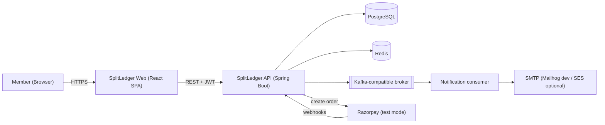
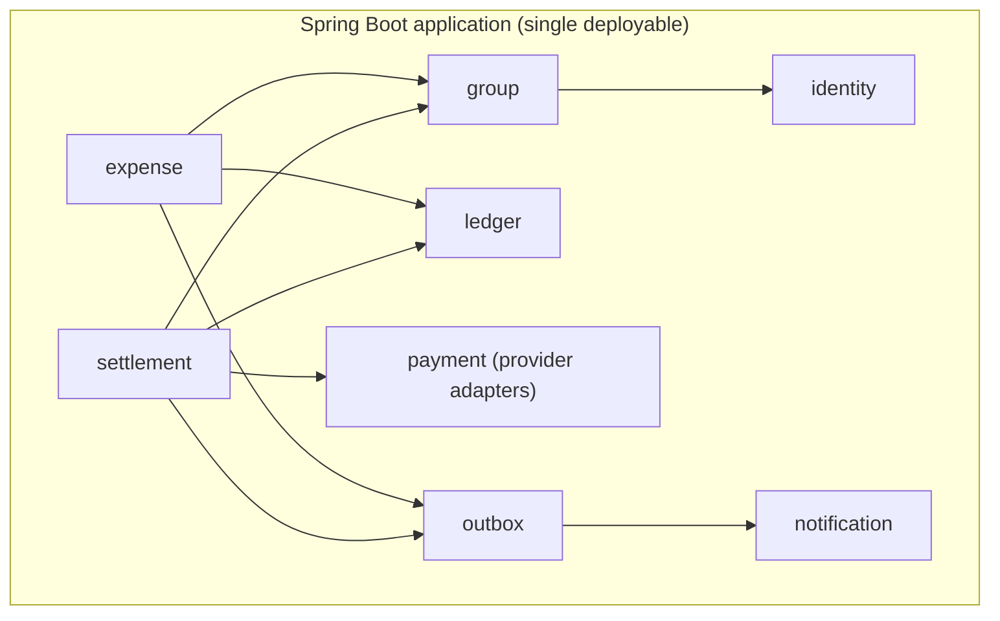
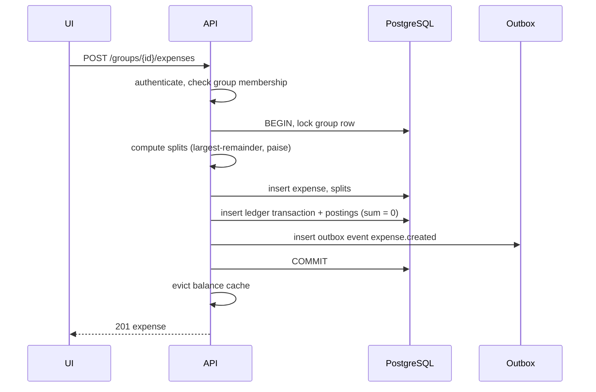
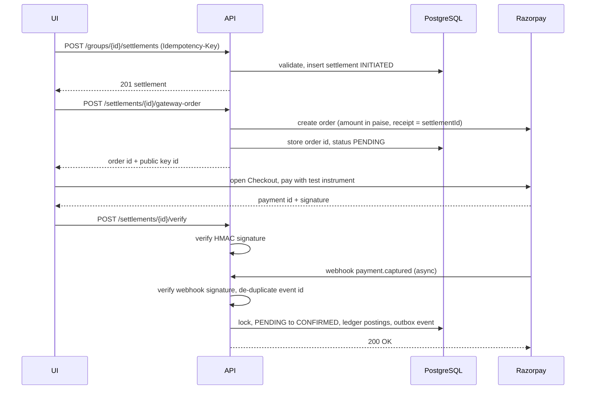
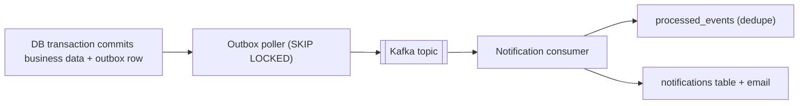

# High-Level Design (HLD)

**System:** SplitLedger | **Version:** 1.0 | **Status:** Draft for implementation

---

## 1. Purpose and scope

SplitLedger lets groups (roommates, trips, teams) record shared expenses, see who owes whom, and settle up, including through a payment gateway in **Razorpay test mode**.

### Goals
1. Correct money handling (no rounding loss, no double-counting, no drift).
2. A clean, defensible architecture a solo developer can finish in about 6 to 7 weeks.
3. Production-style delivery: containers, CI/CD, cloud deployment, observability.

### Non-goals
- Real money movement, wallets holding customer funds, KYC, regulatory compliance. **No real money
  moves anywhere in this product.** The deployed instance settles through Razorpay **test mode**,
  cash, or the sandbox provider. The `UPI_INTENT` adapter is built and tested but disabled in the
  deployed instance, because it is the only method that could reach a real bank account while the
  expense data is fictional (`RUNNING_LIVE.md §2`).
- Native mobile apps (responsive web only).
- Multi-currency conversion (schema carries a currency code, but only INR is supported in v1).
- Horizontal scale beyond a single small deployment (a scaling path is described in section 12).
- Friend-level (non-group) balances. Every balance in v1 is scoped to a group. This is the first difference anyone will notice against Splitwise, so it is stated rather than implied.

---

## 2. Actors

| Actor | Description |
|---|---|
| Member | Registered user who belongs to one or more groups |
| Group admin | Member who created the group; can add/remove members |
| Razorpay | External gateway (test mode); calls back via webhooks |
| Operator (you) | Deploys, monitors, reconciles |

---

## 3. Functional requirements

| ID | Requirement |
|---|---|
| FR-1 | Users register, log in, and stay signed in via refresh tokens |
| FR-2 | Users create groups and add/remove members |
| FR-3 | Members add expenses with one payer and a split among participants (equal, exact, percentage, shares) |
| FR-4 | Expenses can be corrected (replace) or voided without losing history |
| FR-5 | Users see net balance per member, pairwise debts, and a simplified settlement plan |
| FR-6 | Users settle a debt via Razorpay test checkout, UPI intent, cash, or sandbox provider |
| FR-7 | Settlements are idempotent and survive retries, duplicate webhooks and late webhooks |
| FR-8 | Members receive notifications (in-app and email) for new expenses and settlements |
| FR-9 | An activity feed shows who did what in a group (derived, not stored -- LLD §6.4) |
| FR-10 | A user is invited by email and **joins only by accepting**; nobody is added to a group without consent |
| FR-11 | A user can request account deletion: the user record is anonymised, ledger postings are retained |

---

## 4. Non-functional requirements

| Category | Target |
|---|---|
| Correctness | Postings per ledger transaction sum to exactly 0. Nightly reconciliation reports zero drift. |
| Performance (goals to verify with k6) | Reads p95 < 200 ms at 200 req/s; writes p95 < 400 ms at 50 req/s on a small VM |
| Security | JWT auth, per-group authorisation on every route, webhook signature checks, rate limiting, no secrets in git |
| Availability | ~99% monthly, best effort, single instance, no HA claim. The app host is stateless, so recovery is "redeploy". **Data loss up to the last nightly dump is accepted and stated publicly** — this is a demo with disposable data, not a system of record for anyone's finances (`RUNNING_LIVE.md §1`, §6) |
| Maintainability | At least 80% coverage on domain/application layers; ArchUnit enforces module boundaries. Integration tests are **CI-only** (no local Docker -- ADR-012) |
| Observability | Metrics, structured logs with correlation IDs, health checks |
| Portability | Production runs from `docker compose up` **on the VM**; local development runs the JVM and Vite directly against managed dev data stores (ADR-012) |

---

## 5. System context

---

## 6. Container view (deployment units)

| Container | Tech | Responsibility |
|---|---|---|
| Reverse proxy | Caddy | TLS termination, routes `/` to web and `/api` + `/webhooks` to API |
| Web | React SPA served by nginx | UI |
| API | Spring Boot | All business logic, REST API, webhook endpoint, outbox publisher, notification consumer (separate Spring profile, same image) |
| Database | PostgreSQL 16 | System of record |
| Cache | Redis 7 | Balance cache, rate-limit counters |
| Broker | Redpanda (Kafka API) | Domain events |
| Observability | Grafana Cloud (free tier) via Prometheus remote-write | Metrics and dashboards, with no container to host or forget |

The **notification consumer** runs from the same image with `SPRING_PROFILES_ACTIVE=consumer`. This shows event-driven separation without the operational cost of many services.

---

## 7. Backend module view (modular monolith)

Rules (enforced by ArchUnit tests):
- No cyclic dependencies between modules.
- Controllers never touch repositories directly.
- `ledger` knows nothing about expenses or settlements; it only posts balanced transactions.
- Only `payment` talks to Razorpay.

---

## 8. Key flows

### 8.1 Add an expense

### 8.2 Settle through Razorpay (test mode)

The webhook is the source of truth. The client callback only improves UX; both paths call the same idempotent `confirm` use case.

### 8.3 Event propagation

Delivery is **at-least-once**; consumers are idempotent.

---

## 9. Data architecture

| Store | Holds | Notes |
|---|---|---|
| PostgreSQL | Users, groups, expenses, splits, ledger, settlements, idempotency keys, webhook events, outbox, notifications | Single source of truth; Flyway migrations |
| Redis | `bal:{groupId}` cache (TTL 5 min), rate-limit buckets | Safe to lose; never a source of truth |
| Kafka topics | `expense.events`, `settlement.events`, `group.events` | Keyed by group id for per-group ordering |

**Source-of-truth model**
- `expenses` + `expense_splits` + `settlements` are the business facts (immutable apart from status).
- `ledger_transactions` + `ledger_postings` are the double-entry record used for net balances and audit.
- A nightly job recomputes balances both ways and alerts on any mismatch.

---

## 10. Technology choices (and why)

| Decision | Choice | Reason |
|---|---|---|
| Architecture style | Modular monolith + one consumer profile | A solo 6-week project cannot afford microservice overhead; boundaries are still enforced and extractable |
| Money type | `BIGINT` paise / Java `long` | No floating point, no rounding surprises, matches Razorpay's unit |
| DB | PostgreSQL | Transactions, row locks, `SKIP LOCKED`, JSONB |
| Broker | Kafka API via Redpanda | Same client code as Kafka, far lighter on a small VM |
| Auth | JWT access (15 min) + rotating refresh (7 days) | Stateless API, revocable sessions |
| Frontend | React + TS + Vite | Industry standard, fast tooling |
| Delivery | GitHub Actions + GHCR + SSH deploy to EC2 | Simple, visible, cheap; shows Docker and Linux skills |
| Dev data stores | Managed free tiers (Postgres, Redis, SMTP); Docker only in CI and on the VM | No database or Docker daemon on the development machine (ADR-012). Real Postgres, so `FOR UPDATE`, `SKIP LOCKED`, `JSONB` and partial indexes behave as designed |

---

## 11. Security architecture

| Threat | Control |
|---|---|
| Broken access control (IDOR) | `GroupAccessGuard` on every group-scoped route; tests that member of group A cannot read group B |
| Credential theft | BCrypt hashing, refresh token rotation with hashed storage, short access TTL |
| Forged payment callbacks | HMAC-SHA256 verification over the raw body using constant-time comparison |
| Replay / duplicate webhooks | Unique `(provider, event_id)` + idempotent state transitions |
| Duplicate client requests | `Idempotency-Key` required on money-creating endpoints |
| Brute force / abuse | Redis token-bucket rate limits on auth and payment endpoints |
| Injection | Parameterised queries (JPA), Bean Validation on all DTOs |
| Secrets exposure | Env vars, GitHub Secrets, AWS SSM Parameter Store; never logged |
| Vulnerable dependencies | Dependabot + Trivy in CI (secret scanning blocks from day one; vulnerability gate promoted to blocking once the baseline is clean) |
| API reconnaissance | springdoc / Swagger UI disabled in the `prod` profile |
| Unwanted group membership | Invite + explicit accept (FR-10); a pending invite exposes nothing but the group name and the inviter |
| Over-sharing member PII | Inside a group only name is exposed; email is never broadcast, and a VPA is shown only to the counterparty of an actual settlement |
| Abuse of invite email | Rate limit per inviter and per group; one open invite per email per group |
| Transport | HTTPS via Caddy (automatic certificates), CORS locked to the web origin |

---

## 12. Scalability path (what changes if this had to grow)

| Bottleneck | Mitigation |
|---|---|
| Per-group write lock | Lock scope is a single group, so unrelated groups scale linearly; shard by group id later |
| Balance reads | Redis cache, then read replicas |
| Single API instance | Stateless API; run N instances behind a load balancer |
| Outbox poller | `SKIP LOCKED` already supports multiple pollers |
| Module extraction | `payment` and `notification` are the first candidates to become services |

---

## 13. Observability

- **Metrics:** request latency histograms, `settlements_confirmed_total`, `webhook_duplicates_total`, `outbox_lag_seconds`, `ledger_reconciliation_drift`.
- **Logs:** JSON, with `correlationId`, `userId`, `groupId`; no PII or tokens.
- **Health:** `/actuator/health` (liveness and readiness), used by the deployment smoke test.
- **Dashboards:** request rate and latency, error rate, JVM, DB pool, outbox lag.

---

## 14. Risks

| Risk | Impact | Mitigation |
|---|---|---|
| Scope creep | Never finishes | Strict MVP cut line in `ROADMAP.md`; stretch items stay in backlog |
| Razorpay webhook testing from localhost | Blocks Phase 4 | Use a tunnel (ngrok/cloudflared) or the signed-webhook simulation script |
| 2 GB VM too small for all containers | Crashes in production | Cap JVM heap, Redpanda memory, or use a larger instance |
| Overclaiming on resume | Credibility loss | Say "Razorpay test mode"; quote only measured numbers |
| Burnout / long gaps | Project stalls | 1-week sprints, small stories, public board |
| Free-tier dev stores sleep, throttle or expire | Local development and the demo stall | Tolerate cold starts in tests; nothing demo-critical lives only there; a documented 30-minute path to another provider |
| Local test runs need connectivity | Slow or blocked work offline | Unit and property tests stay fully offline; only the `@Tag("cloud")` suite needs the network |
| Managed Kafka free tiers are scarce | Phase 5 cannot run | Publisher sits behind an interface; an in-process `LocalEventBus` keeps the outbox demoable with no broker |

---

## 15. Architecture Decision Records (summary)

| ADR | Decision | Status |
|---|---|---|
| ADR-001 | Modular monolith instead of microservices | Accepted |
| ADR-002 | Money as integer paise (`BIGINT`) | Accepted |
| ADR-003 | Immutable ledger; corrections via reversal, edits via replace | Accepted |
| ADR-004 | Per-group row lock for money-affecting writes; optimistic `version` for edits | Accepted |
| ADR-005 | Transactional outbox for event publishing | Accepted |
| ADR-006 | `PaymentProvider` port; Razorpay test mode as one adapter | Accepted |
| ADR-007 | Idempotency keys stored in PostgreSQL (durable), not Redis | Accepted |
| ADR-008 | Trunk-based development with short-lived branches | Accepted |
| ADR-009 | Single VM + Docker Compose for first cloud deployment; ECS/RDS as stretch | Accepted |
| ADR-010 | Settlements are validated against **net** balances, not pairwise debt, so simplified-plan transfers are payable | Accepted |
| ADR-011 | Access token in memory; refresh token in an `httpOnly; SameSite=Strict` cookie scoped to the refresh path | Accepted |
| ADR-012 | No database or Docker on the development machine: managed dev data stores, Testcontainers in CI only | Accepted |
| ADR-013 | Ship as a public demo: Razorpay test mode is the live settlement method, `UPI_INTENT` is disabled in the deployed instance, and the demo **is** production (one environment) | Accepted |

Full ADRs live in `docs/adr/NNN-title.md` using the template in `AGILE.md`.
