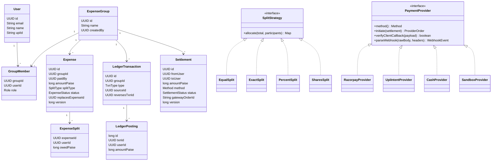
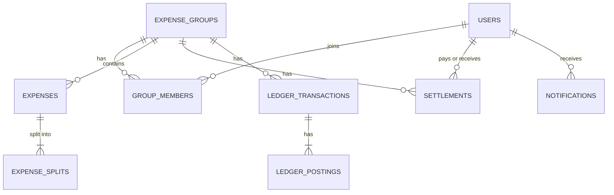
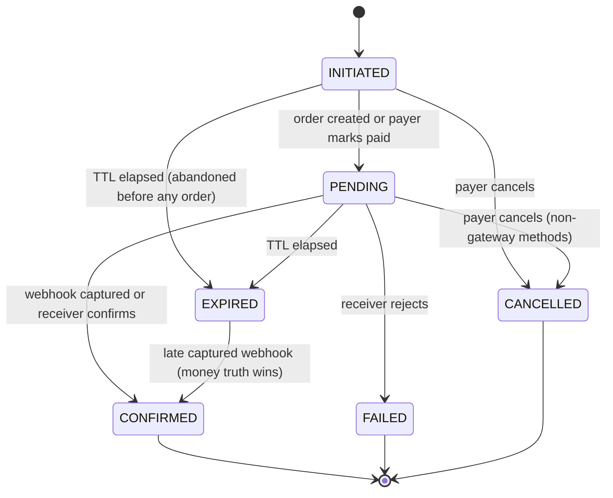
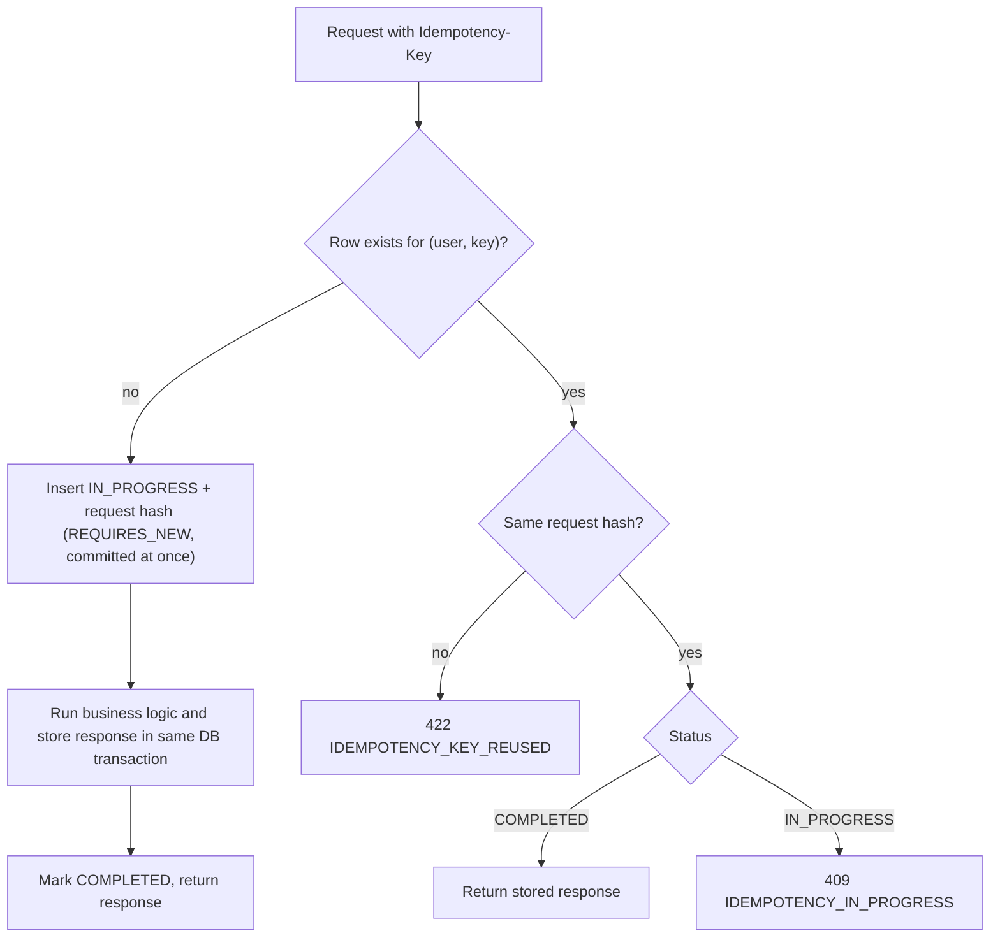

# Low-Level Design (LLD)

**System:** SplitLedger | **Companion to:** `HLD.md`

---

## 1. Backend package structure

Package-by-feature. Each module has the same internal layers.

```
com.splitledger
├── identity/        api (AuthController, UserController) | application | domain | infra
├── group/           api | application (GroupService, GroupAccessGuard) | domain | infra
├── expense/         api | application (ExpenseService) | domain (SplitStrategy impls) | infra
├── ledger/          application (LedgerService) | domain (LedgerTransaction, Posting) | infra
├── settlement/      api | application (SettlementService, SimplificationService) | domain (state machine) | infra
├── payment/         port (PaymentProvider) | razorpay | upi | cash | sandbox | webhook
├── notification/    consumer | application | infra
├── outbox/          OutboxEvent, OutboxPublisher
└── common/          money, errors (problem+json), idempotency, security, config
```

### Main dependencies (`pom.xml`)
`spring-boot-starter-web`, `-validation`, `-security`, `-data-jpa`, `-data-redis`, `-actuator`,
`-mail`, `spring-boot-starter-kafka`, `spring-boot-starter-flyway`, `postgresql`,
`springdoc-openapi-starter-webmvc-ui`, `micrometer-registry-prometheus`, `jjwt` (or Nimbus),
`bucket4j`, `razorpay-java`, `logstash-logback-encoder`.

> **Updated for the Spring Boot 4.1 baseline (ADR-016).** Boot 4 renamed two of these: it is
> `spring-boot-starter-kafka` (not `spring-kafka`) and `spring-boot-starter-flyway` (not
> `flyway-core` plus `flyway-database-postgresql`, which the starter brings in). **springdoc must
> be the 3.x line** — 2.x targets Boot 3 — and neither springdoc nor ArchUnit is version-managed
> by the parent, so both are pinned explicitly in the pom.
Test: `spring-boot-starter-test`, `testcontainers` (postgresql, kafka/redpanda, generic Redis),
`spring-kafka-test` (in-JVM `EmbeddedKafkaBroker`), `greenmail-junit5` (in-JVM SMTP), `jqwik`,
`archunit-junit5`, `rest-assured`, `awaitility`. Plugins: JaCoCo, Spotless.

> **Where tests run (ADR-012).** Testcontainers needs a Docker daemon, which the development
> machine does not provide, so the Testcontainers suite is **CI-only** (`-PciIT`). Locally:
> unit and jqwik property tests run fully offline, and a `@Tag("cloud")` suite runs against the
> managed dev Postgres/Redis. A story is Done only when CI is green -- a green local run is
> necessary but not sufficient.

---

## 2. Domain model



### Design patterns used

| Pattern | Where | Why |
|---|---|---|
| Strategy | `SplitStrategy` implementations | Add a split type without touching existing code |
| Ports and adapters | `PaymentProvider` + provider classes | Swap gateways, test without network |
| State | `Settlement` transitions | Illegal transitions are impossible |
| Value object | `Money` (paise `long`) | One place for arithmetic and validation |
| Transactional outbox | `outbox_events` | Reliable event publishing |
| Repository / Unit of Work | Spring Data JPA | Standard persistence |
| Template method | Webhook handling skeleton | Verify, dedupe, dispatch, acknowledge |

---

## 3. Database design

### 3.1 ER diagram



### 3.2 DDL (Flyway `V1__init.sql`)

> **Validated in the application layer, not by the schema.** A composite FK cannot express
> "this user is an *active* member of *this* group", so every money-affecting write checks it:
> `expenses.paid_by`, every `expense_splits.user_id`, and `settlements.from_user` / `to_user`
> must be rows in `group_members` for that group with `left_at IS NULL`.
> There is one test per endpoint proving a foreign user is rejected with 422.

```sql
CREATE TABLE users (
  id            UUID PRIMARY KEY,
  email         VARCHAR(254) NOT NULL UNIQUE,
  name          VARCHAR(100) NOT NULL,
  password_hash VARCHAR(100) NOT NULL,
  upi_id        VARCHAR(100),
  created_at    TIMESTAMPTZ NOT NULL DEFAULT now()
);

CREATE TABLE refresh_tokens (
  id          UUID PRIMARY KEY,
  user_id     UUID NOT NULL REFERENCES users(id),
  token_hash  VARCHAR(64) NOT NULL UNIQUE,
  expires_at  TIMESTAMPTZ NOT NULL,
  revoked_at  TIMESTAMPTZ,
  replaced_by UUID
);

CREATE TABLE expense_groups (
  id         UUID PRIMARY KEY,
  name       VARCHAR(100) NOT NULL,
  currency   CHAR(3) NOT NULL DEFAULT 'INR' CHECK (currency = 'INR'),   -- v1 is INR-only
  created_by UUID NOT NULL REFERENCES users(id),
  created_at TIMESTAMPTZ NOT NULL DEFAULT now()
);

CREATE TABLE group_members (
  group_id  UUID NOT NULL REFERENCES expense_groups(id),
  user_id   UUID NOT NULL REFERENCES users(id),
  role      VARCHAR(10) NOT NULL CHECK (role IN ('ADMIN','MEMBER')),
  joined_at TIMESTAMPTZ NOT NULL DEFAULT now(),
  left_at   TIMESTAMPTZ,
  PRIMARY KEY (group_id, user_id)
);
-- Re-joining reuses the row: the PK forbids a second one, so an add on a departed
-- member is an UPSERT that clears left_at and resets joined_at. Ledger history
-- survives departure untouched; balances are never recomputed from membership.

CREATE TABLE expenses (
  id                  UUID PRIMARY KEY,
  group_id            UUID NOT NULL REFERENCES expense_groups(id),
  paid_by             UUID NOT NULL REFERENCES users(id),
  description         VARCHAR(200) NOT NULL,
  amount_paise        BIGINT NOT NULL CHECK (amount_paise BETWEEN 1 AND 100000000),  -- max ₹10,00,000, see 4.1
  currency            CHAR(3) NOT NULL DEFAULT 'INR',
  split_type          VARCHAR(10) NOT NULL CHECK (split_type IN ('EQUAL','EXACT','PERCENT','SHARES')),
  status              VARCHAR(10) NOT NULL DEFAULT 'ACTIVE' CHECK (status IN ('ACTIVE','VOIDED')),
  replaces_expense_id UUID REFERENCES expenses(id),
  expense_date        DATE NOT NULL,
  created_by          UUID NOT NULL REFERENCES users(id),
  created_at          TIMESTAMPTZ NOT NULL DEFAULT now(),
  version             BIGINT NOT NULL DEFAULT 0
);
CREATE INDEX idx_expenses_group ON expenses(group_id, expense_date DESC);

CREATE TABLE expense_splits (
  expense_id  UUID NOT NULL REFERENCES expenses(id),
  user_id     UUID NOT NULL REFERENCES users(id),
  owed_paise  BIGINT NOT NULL CHECK (owed_paise >= 0),
  input_value BIGINT,          -- exact paise / basis points / share count as entered
  PRIMARY KEY (expense_id, user_id)
);

CREATE TABLE ledger_transactions (
  id               UUID PRIMARY KEY,
  group_id         UUID NOT NULL REFERENCES expense_groups(id),
  type             VARCHAR(12) NOT NULL CHECK (type IN ('EXPENSE','SETTLEMENT','REVERSAL')),
  source_id        UUID NOT NULL,
  reverses_txn_id  UUID REFERENCES ledger_transactions(id),
  created_at       TIMESTAMPTZ NOT NULL DEFAULT now()
);
-- One ledger transaction per business fact. A retry or a bug cannot post the same
-- expense or settlement twice; reversals are exempt (a txn may be reversed once per correction).
CREATE UNIQUE INDEX uq_ledger_txn_source ON ledger_transactions(type, source_id)
  WHERE type <> 'REVERSAL';

CREATE TABLE ledger_postings (
  id           BIGSERIAL PRIMARY KEY,
  txn_id       UUID NOT NULL REFERENCES ledger_transactions(id),
  group_id     UUID NOT NULL,
  user_id      UUID NOT NULL REFERENCES users(id),
  amount_paise BIGINT NOT NULL CHECK (amount_paise <> 0)   -- + is owed to user, - user owes
);
CREATE INDEX idx_postings_group_user ON ledger_postings(group_id, user_id);
CREATE INDEX idx_postings_txn ON ledger_postings(txn_id);          -- reversal lookups

CREATE TABLE settlements (
  id                 UUID PRIMARY KEY,
  group_id           UUID NOT NULL REFERENCES expense_groups(id),
  from_user          UUID NOT NULL REFERENCES users(id),
  to_user            UUID NOT NULL REFERENCES users(id),
  amount_paise       BIGINT NOT NULL CHECK (amount_paise > 0),
  method             VARCHAR(12) NOT NULL CHECK (method IN ('RAZORPAY','UPI_INTENT','CASH','SANDBOX')),
  status             VARCHAR(12) NOT NULL CHECK (status IN ('INITIATED','PENDING','CONFIRMED','FAILED','CANCELLED','EXPIRED')),
  gateway_order_id   VARCHAR(64) UNIQUE,
  gateway_payment_id VARCHAR(64),
  expires_at         TIMESTAMPTZ,
  created_at         TIMESTAMPTZ NOT NULL DEFAULT now(),
  confirmed_at       TIMESTAMPTZ,
  version            BIGINT NOT NULL DEFAULT 0,
  CHECK (from_user <> to_user)
);
CREATE INDEX idx_settlements_group ON settlements(group_id, created_at DESC);
CREATE INDEX idx_settlements_pending ON settlements(status, expires_at) WHERE status = 'PENDING';

CREATE TABLE webhook_events (
  id                UUID PRIMARY KEY,
  provider          VARCHAR(20) NOT NULL,
  provider_event_id VARCHAR(100) NOT NULL,
  event_type        VARCHAR(50) NOT NULL,
  payload           JSONB NOT NULL,
  received_at       TIMESTAMPTZ NOT NULL DEFAULT now(),
  processed_at      TIMESTAMPTZ,
  status            VARCHAR(12) NOT NULL DEFAULT 'RECEIVED'
                      CHECK (status IN ('RECEIVED','PROCESSED','FAILED','IGNORED')),
  UNIQUE (provider, provider_event_id)
);

CREATE TABLE idempotency_keys (
  user_id         UUID NOT NULL REFERENCES users(id),
  idem_key        VARCHAR(100) NOT NULL,
  request_hash    VARCHAR(64) NOT NULL,
  status          VARCHAR(12) NOT NULL,           -- IN_PROGRESS | COMPLETED
  response_status INT,
  response_body   JSONB,
  created_at      TIMESTAMPTZ NOT NULL DEFAULT now(),
  PRIMARY KEY (user_id, idem_key)
);

CREATE TABLE outbox_events (
  id             UUID PRIMARY KEY,
  aggregate_type VARCHAR(30) NOT NULL,
  aggregate_id   UUID NOT NULL,
  event_type     VARCHAR(50) NOT NULL,
  payload        JSONB NOT NULL,
  created_at     TIMESTAMPTZ NOT NULL DEFAULT now(),
  published_at   TIMESTAMPTZ
);
CREATE INDEX idx_outbox_unpublished ON outbox_events(created_at) WHERE published_at IS NULL;

CREATE TABLE processed_events (        -- consumer-side de-duplication
  consumer   VARCHAR(50) NOT NULL,
  event_id   UUID NOT NULL,
  handled_at TIMESTAMPTZ NOT NULL DEFAULT now(),
  PRIMARY KEY (consumer, event_id)
);

CREATE TABLE notifications (
  id         UUID PRIMARY KEY,
  user_id    UUID NOT NULL REFERENCES users(id),
  type       VARCHAR(40) NOT NULL,
  payload    JSONB NOT NULL,
  read_at    TIMESTAMPTZ,
  created_at TIMESTAMPTZ NOT NULL DEFAULT now()
);
CREATE INDEX idx_notifications_user ON notifications(user_id, created_at DESC);

-- Nobody joins a group without accepting. An invite may target an email that has
-- no account yet; accepting after registration is the same code path.
CREATE TABLE group_invites (
  id          UUID PRIMARY KEY,
  group_id    UUID NOT NULL REFERENCES expense_groups(id),
  email       VARCHAR(254) NOT NULL,
  invited_by  UUID NOT NULL REFERENCES users(id),
  token_hash  VARCHAR(64) NOT NULL UNIQUE,          -- SHA-256 of the emailed token
  status      VARCHAR(10) NOT NULL DEFAULT 'PENDING'
              CHECK (status IN ('PENDING','ACCEPTED','DECLINED','EXPIRED','REVOKED')),
  expires_at  TIMESTAMPTZ NOT NULL,
  created_at  TIMESTAMPTZ NOT NULL DEFAULT now(),
  responded_at TIMESTAMPTZ
);
CREATE UNIQUE INDEX uq_invite_open ON group_invites(group_id, lower(email))
  WHERE status = 'PENDING';
```

**No `activity` table.** The feed (FR-9) is a derived read over `expenses`, `settlements`
and `group_members` -- see 6.4. Nothing is written twice, so nothing can disagree.

---

## 4. Money and split calculation

### 4.1 Rules
- Amounts are `long` paise. Maximum single expense: ₹10,00,000 (`100_000_000` paise) so intermediate products fit in `long`. **Enforced in two places:** a DB `CHECK` on `expenses.amount_paise` and a Bean Validation `@Max` on the DTO.
- Percentages are stored as **basis points** (100.00% = 10,000).
- Shares are integers in `1..1000`. **The cap matters:** `allocate()` computes `total * weight`, so an unbounded share count overflows `long`. Validate before allocating.
- Participants per expense: `1..50`. This bounds the allocation loop, the posting count per transaction, and the abuse surface.
- Every strategy must return allocations whose **sum equals the total exactly**.

### 4.2 Strategy outcomes

| Type | Input | Validation |
|---|---|---|
| EQUAL | participant ids | 1 to 50 participants |
| EXACT | `{user: paise}` | sum equals total, each >= 0 |
| PERCENT | `{user: basis points}` | sum equals 10,000 |
| SHARES | `{user: share count}` | each share in `1..1000` |

EQUAL, PERCENT and SHARES all reduce to the **largest-remainder method** with weights (EQUAL uses weight 1 each, PERCENT uses basis points). EXACT is validated and used as-is.

### 4.3 Largest-remainder allocation (illustrative code)

```java
static Map<UUID, Long> allocate(long total, SortedMap<UUID, Long> weights) {
    long sumW = weights.values().stream().mapToLong(Long::longValue).sum();
    Map<UUID, Long> out = new LinkedHashMap<>();
    List<Map.Entry<UUID, Long>> remainders = new ArrayList<>();
    long allocated = 0;

    for (var e : weights.entrySet()) {
        long numerator = total * e.getValue();      // no overflow only because total <= 1e8
                                                    // AND weight <= 1e4 (bp) or <= 1e3 (shares) -- see 4.1
        long base = numerator / sumW;
        out.put(e.getKey(), base);
        allocated += base;
        remainders.add(Map.entry(e.getKey(), numerator % sumW));
    }

    long leftover = total - allocated;              // 0 <= leftover < participants
    remainders.sort(
        Map.Entry.<UUID, Long>comparingByValue().reversed()
                 .thenComparing(Map.Entry.comparingByKey()));   // deterministic tie-break
    for (int i = 0; i < leftover; i++) {
        out.merge(remainders.get(i).getKey(), 1L, Long::sum);
    }
    return out;
}
```

**Example:** ₹100 (10,000 paise) split equally among 3 → base 3,333 each, leftover 1 → one participant gets 3,334. Sum is exactly 10,000.

### 4.4 Property-based tests (jqwik)
- For any total and any valid weights, `sum(allocation) == total`.
- No allocation is negative.
- Allocation differs from the exact proportional share by less than 1 paisa.
- Same input always yields the same output (determinism).

---

## 5. Ledger design

### 5.1 Posting convention
A positive posting means "the group owes this user". A negative posting means "this user owes the group". Every ledger transaction sums to **0**.

| Event | Postings |
|---|---|
| Expense (payer P paid T, participant i owes s_i) | P: `+T`; each participant i: `-s_i` |
| Settlement (A pays B an amount X) | A: `+X`; B: `-X` |
| Reversal of transaction Z | the exact opposite sign of every posting in Z, with `reverses_txn_id = Z` |

**Worked example**
1. A pays ₹900, equal split among A, B, C → postings: A `+900`, A `-300`, B `-300`, C `-300`. Net: A `+600`, B `-300`, C `-300`.
2. B pays A ₹300 → postings: B `+300`, A `-300`. Net: A `+300`, B `0`, C `-300`.

### 5.2 Edit and void
- **Void:** insert a reversal transaction, set `expenses.status = 'VOIDED'`.
- **Edit:** in one DB transaction, void the old expense and create a new one with `replaces_expense_id` pointing to it. History is preserved and nothing is mutated.
- Both operations check `expenses.version` (optimistic locking) so two people cannot edit the same expense at once.

### 5.3 Invariants checked by tests and the nightly job
1. `SUM(amount_paise) = 0` for every `txn_id`.
2. `SUM(amount_paise) = 0` for every group.
3. Net balance from postings equals net balance derived from active expenses plus confirmed settlements.

---

## 6. Balances and debt simplification

### 6.1 Net balance
```sql
SELECT user_id, SUM(amount_paise) AS net
FROM ledger_postings
WHERE group_id = :groupId
GROUP BY user_id
HAVING SUM(amount_paise) <> 0;
```

### 6.2 Pairwise balances (who owes whom, derived from source tables)
```sql
WITH debts AS (
  SELECT s.user_id AS debtor, e.paid_by AS creditor, s.owed_paise AS amt
  FROM expense_splits s
  JOIN expenses e ON e.id = s.expense_id
  WHERE e.group_id = :groupId AND e.status = 'ACTIVE' AND s.user_id <> e.paid_by
  UNION ALL
  -- a confirmed settlement from A to B cancels part of A's debt to B
  SELECT to_user, from_user, amount_paise
  FROM settlements
  WHERE group_id = :groupId AND status = 'CONFIRMED'
)
SELECT LEAST(debtor, creditor) AS user_a,
       GREATEST(debtor, creditor) AS user_b,
       SUM(CASE WHEN debtor < creditor THEN amt ELSE -amt END) AS a_owes_b
FROM debts
GROUP BY 1, 2
HAVING SUM(CASE WHEN debtor < creditor THEN amt ELSE -amt END) <> 0;
```
Positive `a_owes_b` means `user_a` owes `user_b`; negative means the reverse. The API normalises this into `{from, to, amount}`.

### 6.3 Simplification (greedy minimum cash flow)

```java
record Node(UUID userId, long amount) {}
record Transfer(UUID from, UUID to, long amountPaise) {}

List<Transfer> simplify(Map<UUID, Long> net) {
    Comparator<Node> byAmountThenId =
        Comparator.comparingLong(Node::amount).reversed().thenComparing(Node::userId);
    var creditors = new PriorityQueue<>(byAmountThenId);
    var debtors   = new PriorityQueue<>(byAmountThenId);

    net.forEach((u, bal) -> {
        if (bal > 0) creditors.add(new Node(u, bal));
        else if (bal < 0) debtors.add(new Node(u, -bal));
    });

    var result = new ArrayList<Transfer>();
    while (!creditors.isEmpty() && !debtors.isEmpty()) {
        Node c = creditors.poll(), d = debtors.poll();
        long x = Math.min(c.amount(), d.amount());
        result.add(new Transfer(d.userId(), c.userId(), x));
        if (c.amount() > x) creditors.add(new Node(c.userId(), c.amount() - x));
        if (d.amount() > x) debtors.add(new Node(d.userId(), d.amount() - x));
    }
    return result;
}
```
- At most `n - 1` transfers for `n` people with non-zero balance.
- Finding the true minimum is NP-hard in general; the greedy approach is the standard practical answer. Say this in interviews.
- Tests: sum of transfers equals sum of debts; applying transfers brings every net balance to 0.
- "Simplified" transfers are **suggestions**, but they are *payable* suggestions: because
   7.2 validates against net balances rather than pairwise debt, a transfer taken straight
   from this plan passes validation even when the two users have no direct debt between them.
   That is the whole point of simplification, and validating pairwise would break it (ADR-010).

---

### 6.4 Activity feed (FR-9)

No `activity` table. The feed is a derived, paginated read so it can never disagree with the
facts it describes:

```sql
SELECT 'EXPENSE_ADDED' AS kind, e.id AS subject_id, e.created_by AS actor,
       e.created_at AS at, jsonb_build_object('description', e.description,
                                              'amountPaise', e.amount_paise) AS detail
FROM expenses e WHERE e.group_id = :groupId
UNION ALL SELECT 'EXPENSE_VOIDED', e.id, e.created_by, e.created_at, '{}'::jsonb
FROM expenses e WHERE e.group_id = :groupId AND e.status = 'VOIDED'
UNION ALL SELECT 'SETTLEMENT_CONFIRMED', s.id, s.from_user, s.confirmed_at,
       jsonb_build_object('toUser', s.to_user, 'amountPaise', s.amount_paise, 'method', s.method)
FROM settlements s WHERE s.group_id = :groupId AND s.status = 'CONFIRMED'
UNION ALL SELECT 'MEMBER_ADDED', gm.user_id, gm.user_id, gm.joined_at, '{}'::jsonb
FROM group_members gm WHERE gm.group_id = :groupId
ORDER BY at DESC
LIMIT :size OFFSET :offset;
```

Keyset pagination on `(at, subject_id)` once a group grows past a few hundred rows.
**Every balance change must produce a feed entry** -- unexplained balance movement is the
fastest way to lose a group's trust in the numbers.

---

## 7. Settlements

### 7.1 State machine



`expires_at` is set at creation and the sweeper (every minute) expires both `INITIATED` and
`PENDING` rows past it:

| Method | TTL | Why |
|---|---|---|
| `RAZORPAY` | 15 min | Matches a checkout session; abandoned carts must not pin a debt |
| `SANDBOX` | 15 min | Same shape as the gateway it stands in for |
| `UPI_INTENT` | 7 days | A human has to open an app and a receiver has to confirm |
| `CASH` | 7 days | Same |

Rules:
- Transitions live in the `Settlement` aggregate (`confirm()`, `markPending()`, `expire()`, ...). Anything else throws `INVALID_STATE_TRANSITION`.
- A `payment.failed` webhook only records an attempt. The Razorpay order stays `PENDING` because the user can retry on the same order. Only expiry ends it.
- `confirm()` on an already `CONFIRMED` settlement is a **no-op that returns success** (idempotent).
- On `CONFIRMED`: ledger postings and an outbox event are written in the same DB transaction.

### 7.2 Creation rules

**ADR-010: the limit is the net balance, not the pairwise debt.**
A simplified transfer is deliberately a payment between two people who often have no direct
debt (A owes B, B owes C, so A pays C). Validating against the pairwise figure from 6.2 would
reject every such transfer and break the feature. So:

```
net = netBalance(groupId)              -- from 6.1, signed paise
require net[from] < 0                  -- the payer must actually owe the group
require net[to]   > 0                  -- the payee must actually be owed
limit = min(-net[from], net[to])
require 0 < amountPaise <= limit       -- else SETTLEMENT_EXCEEDS_OUTSTANDING
```

Other rules:
- `from != to`, both are active group members, and `from` is the authenticated user.
- `method = RAZORPAY` additionally requires `amountPaise >= 100` (₹1, the gateway minimum) --
  rejected by us with our own error code, not by an opaque gateway failure. See 7.4.
- Pending settlements are **not** subtracted from the limit in v1 (documented trade-off).
  Two pending settlements could together exceed the debt, so `confirm()` **re-runs the whole
  check above** and the second one fails with `SETTLEMENT_EXCEEDS_OUTSTANDING`.
- The pairwise figures from 6.2 remain the **display** model ("you owe Rahul ₹300"); they are
  never the authorisation model.

**Overpayment and late corrections.** Voiding or replacing an expense *after* a settlement
against it confirmed can push a balance past zero. That is legal and visible, not an error:
the net balance simply flips sign and the UI reads "Rahul owes you ₹120". No automatic refund,
no silent adjustment, and both parties are notified. Test: expense -> settle -> void the
expense -> balances, pairwise view and simplified plan all stay coherent.

### 7.3 Payment provider port

```java
public interface PaymentProvider {
    Settlement.Method method();
    ProviderOrder initiate(Settlement s);                       // idempotent per settlement
    boolean verifyClientCallback(Map<String, String> payload);  // HMAC check
    Optional<WebhookEvent> parseWebhook(byte[] rawBody, Map<String, String> headers);
}
```

| Provider | Behaviour |
|---|---|
| `RazorpayProvider` | Creates an order (amount in paise, `receipt = settlementId`), verifies signatures, maps webhook events |
| `UpiIntentProvider` | Builds `upi://pay?pa=<vpa>&pn=<name>&am=<rupees>&cu=INR&tn=<note>`; payer marks "I've paid" (PENDING), receiver confirms |
| `CashProvider` | Same manual-confirm flow without a link |
| `SandboxProvider` | Auto-confirms after a configurable delay; used in demos and tests |

### 7.4 Razorpay specifics (verify against current Razorpay docs while building)
- **Minimum amount:** Razorpay rejects orders under ₹1 (100 paise). Enforce it at settlement
  creation (7.2) so the user sees our error, not a gateway error, and no `INITIATED` row is
  stranded. `receipt` is capped at 40 characters by Razorpay; a UUID is 36, so it fits.
- **Order creation:** `amount` in paise, `currency = INR`, `receipt = settlementId`. Store `gateway_order_id` under a unique constraint. Guard against double order creation by checking the stored order id while holding the settlement row lock.
- **Client callback signature:** HMAC-SHA256 of `order_id + "|" + payment_id` with the key secret, compared with `razorpay_signature`.
- **Path (decided once, do not vary):** `POST /webhooks/razorpay` -- **outside** `/api/v1`, with
  no JWT filter and the raw-body caching filter applied. Caddy routes `/webhooks/*` to the API,
  and the Razorpay dashboard is configured with `https://<domain>/webhooks/razorpay`.
- **Webhook signature:** HMAC-SHA256 of the **raw request body** with the webhook secret, compared with the `X-Razorpay-Signature` header. Never re-serialise the JSON before verifying.
- Use constant-time comparison (`MessageDigest.isEqual`).
- Events handled: `payment.captured`, `order.paid`, `payment.failed`. Unknown events are stored and acknowledged with 200.
- Ensure auto-capture is enabled for test mode so `payment.captured` fires.
- **Local webhook testing:** expose the API via a tunnel (ngrok or cloudflared), or run `scripts/simulate-webhook.sh`, which signs a sample payload with `openssl dgst -sha256 -hmac` and POSTs it to your local endpoint.

### 7.5 Webhook processing (template method)
1. Read **raw body bytes** and signature header.
2. Verify signature. Invalid → `400`, increment `webhook_invalid_total`.
3. Insert into `webhook_events` with `(provider, provider_event_id)` unique. On conflict → return `200` (duplicate), increment `webhook_duplicates_total`.
4. Map the event to a settlement through `order_id` (never through client-supplied data).
5. In one DB transaction: lock the settlement row, run the state transition, write postings and the outbox event, mark the webhook event `PROCESSED`.
6. Return `200` quickly. Any exception → `500` so Razorpay retries (processing is idempotent).

---

## 8. Idempotency

Applies to `POST /groups/{id}/settlements` and `POST /groups/{id}/expenses` (header `Idempotency-Key`, client UUID).



**Why the marker gets its own transaction (and why it matters).** If the `IN_PROGRESS` row were
inserted in the *same* transaction as the business logic, no concurrent duplicate could ever see
it -- the second request would block on the unique index until commit and then fail on a unique
violation, so the advertised `409 IDEMPOTENCY_IN_PROGRESS` would be unreachable. The marker is
therefore written in a `REQUIRES_NEW` transaction and committed before the work starts; the
response is stored on completion. A marker left `IN_PROGRESS` by a crash is reclaimed by the
purge job after 10 minutes.

- Keys are scoped per user. Rows older than 24 hours are purged by a scheduled job.
- The gateway order step is a separate endpoint made idempotent **by state**: if `gateway_order_id` already exists, return it instead of creating another.

---

## 9. Concurrency design

| Scenario | Mechanism |
|---|---|
| Two writes in the same group affecting balances | `SELECT ... FROM expense_groups WHERE id = :id FOR UPDATE` at the start of the transaction serialises them; different groups run in parallel |
| Two people edit or void the same expense | `expenses.version` optimistic lock → `409 VERSION_CONFLICT` |
| Duplicate or concurrent webhooks | Unique event id + settlement row lock + idempotent transition |
| Multiple outbox pollers | `SELECT ... FOR UPDATE SKIP LOCKED` |
| Client retries | Idempotency keys |

**Mandatory concurrency tests**
1. 50 threads each settle a different slice of the same debt; final balances are exact and no overpayment is accepted.
2. The same webhook delivered 20 times in parallel produces exactly one ledger transaction.
3. Two simultaneous edits of one expense: exactly one succeeds.

---

## 10. Events and outbox

### 10.1 Event envelope
```json
{
  "eventId": "uuid",
  "type": "settlement.confirmed",
  "occurredAt": "2026-01-01T10:15:30Z",
  "groupId": "uuid",
  "payload": { "settlementId": "uuid", "fromUser": "uuid", "toUser": "uuid", "amountPaise": 30000 }
}
```

### 10.2 Topics and events

| Topic | Events |
|---|---|
| `expense.events` | `expense.created`, `expense.voided`, `expense.replaced` |
| `settlement.events` | `settlement.created`, `settlement.confirmed`, `settlement.expired` |
| `group.events` | `member.added`, `member.removed` |

### 10.3 Publisher
- `@Profile("!consumer")` on the publisher and `@Profile("consumer")` on the listener. Both
  containers run the same image, so without this the API and the consumer would both poll the
  outbox. `SKIP LOCKED` would keep that safe, but safety by accident is not a design.
- `@Scheduled(fixedDelay = 500)`: select up to 100 unpublished rows `FOR UPDATE SKIP LOCKED`, publish with key `groupId`, `acks=all`, `enable.idempotence=true`, then set `published_at`.
- Failure leaves rows unpublished; they are retried on the next tick. Metric: `outbox_lag_seconds`.

### 10.4 Consumer (`consumer` profile)
- For each event: insert `(consumer, event_id)` into `processed_events`; on conflict, skip.
- Create a `notifications` row for affected members and send an email through SMTP (Mailhog in dev).
- Poison messages go to a dead-letter topic `*.dlq` after 3 retries with backoff.

---

## 11. API specification

Base path `/api/v1`. JSON. Auth via `Authorization: Bearer <accessToken>` unless noted.
**Exception:** the webhook endpoint is **not** under `/api/v1` and not under the JWT filter --
it is `POST /webhooks/razorpay` (see 7.4). It is the only path outside the base path.

### 11.1 Endpoints

| Method | Path | Description | Notes |
|---|---|---|---|
| POST | `/auth/register` | Create account | public, rate limited |
| POST | `/auth/login` | Get access + refresh tokens | public, rate limited |
| POST | `/auth/refresh` | Rotate refresh token | public |
| POST | `/auth/logout` | Revoke refresh token | |
| GET | `/users/me` | Current profile | |
| PATCH | `/users/me` | Update name, UPI id | |
| POST | `/groups` | Create group | |
| GET | `/groups` | My groups | |
| GET | `/groups/{id}` | Group detail with members | member only |
| POST | `/groups/{id}/members` | Add member by email | admin only |
| DELETE | `/groups/{id}/members/{userId}` | Remove member | admin; blocked if balance ≠ 0 |
| POST | `/groups/{id}/invites` | Invite by email (account optional) | admin only, rate limited |
| GET | `/groups/{id}/invites` | List open invites | admin only |
| DELETE | `/groups/{id}/invites/{inviteId}` | Revoke an invite | admin only |
| GET | `/invites/{token}` | Preview an invite (group name, inviter) | public, token-scoped |
| POST | `/invites/{token}/accept` | Join the group | authenticated; email must match |
| POST | `/invites/{token}/decline` | Decline | authenticated |
| POST | `/groups/{id}/expenses` | Create expense | `Idempotency-Key` |
| GET | `/groups/{id}/expenses` | List (paged) | `page`, `size`, `status` |
| GET | `/expenses/{id}` | Detail with splits | |
| PUT | `/expenses/{id}` | Replace expense | `If-Match: version` |
| DELETE | `/expenses/{id}` | Void expense | `If-Match: version` |
| GET | `/groups/{id}/balances` | Net balances + pairwise | cached |
| GET | `/groups/{id}/balances/simplified` | Suggested transfers | cached |
| POST | `/groups/{id}/settlements` | Create settlement | `Idempotency-Key` |
| GET | `/groups/{id}/settlements` | List settlements | |
| GET | `/settlements/{id}` | Single settlement (status polling, 14.4) | member only |
| POST | `/settlements/{id}/gateway-order` | Create Razorpay order | RAZORPAY only, idempotent |
| POST | `/settlements/{id}/verify` | Client callback signature check | |
| POST | `/settlements/{id}/mark-paid` | Payer says "I've paid" | UPI_INTENT, CASH |
| POST | `/settlements/{id}/confirm` | Receiver confirms | UPI_INTENT, CASH |
| POST | `/settlements/{id}/reject` | Receiver rejects | |
| POST | `/settlements/{id}/cancel` | Payer cancels | |
| GET | `/groups/{id}/activity` | Activity feed | |
| GET | `/notifications` | My notifications | paged |
| POST | `/notifications/{id}/read` | Mark one read | sets `read_at` |
| POST | `/notifications/read-all` | Mark all read | |
| GET | `/health-check` | Liveness for the deploy smoke test | public, no auth, no DB call |
| POST | `/webhooks/razorpay` | Gateway callback | public, signature-verified, **not** under JWT, **not** under `/api/v1` |

### 11.2 Example: create expense

Request:
```json
POST /api/v1/groups/6b1e.../expenses
Idempotency-Key: 0f9c7a52-...

{
  "description": "Dinner",
  "amountPaise": 90000,
  "paidBy": "a1...",
  "expenseDate": "2026-01-10",
  "splitType": "EQUAL",
  "participants": [
    { "userId": "a1..." },
    { "userId": "b2..." },
    { "userId": "c3..." }
  ]
}
```
Response `201`:
```json
{
  "id": "e9...",
  "amountPaise": 90000,
  "splits": [
    { "userId": "a1...", "owedPaise": 30000 },
    { "userId": "b2...", "owedPaise": 30000 },
    { "userId": "c3...", "owedPaise": 30000 }
  ],
  "version": 0
}
```

### 11.3 Example: create settlement
```json
POST /api/v1/groups/6b1e.../settlements
Idempotency-Key: 7d1e...

{ "toUser": "a1...", "amountPaise": 30000, "method": "RAZORPAY" }
```
Response `201`: `{ "id": "s1...", "status": "INITIATED", "amountPaise": 30000, "method": "RAZORPAY" }`

### 11.4 Error model (RFC 7807 `application/problem+json`)
```json
{
  "type": "https://splitledger.dev/errors/split-sum-mismatch",
  "title": "Split amounts do not add up",
  "status": 422,
  "code": "SPLIT_SUM_MISMATCH",
  "detail": "Exact splits total 89900 but expense is 90000",
  "correlationId": "c0a8..."
}
```

| Code | HTTP | Meaning |
|---|---|---|
| `VALIDATION_ERROR` | 400 | Bean validation failure |
| `UNAUTHENTICATED` | 401 | Missing/invalid/expired token |
| `FORBIDDEN` / `NOT_GROUP_MEMBER` | 403 | Not allowed |
| `NOT_FOUND` | 404 | Resource missing (also used for other groups' resources) |
| `VERSION_CONFLICT` | 409 | Stale `version` |
| `IDEMPOTENCY_IN_PROGRESS` | 409 | Same key still running |
| `IDEMPOTENCY_KEY_REUSED` | 422 | Same key, different body |
| `SPLIT_SUM_MISMATCH` | 422 | Splits do not equal the total |
| `SETTLEMENT_EXCEEDS_OUTSTANDING` | 422 | Paying more than the net balance allows (7.2) |
| `SETTLEMENT_BELOW_GATEWAY_MINIMUM` | 422 | Razorpay settlement under ₹1 (7.4) |
| `PARTICIPANT_NOT_MEMBER` | 422 | Payer or participant is not an active member of the group |
| `CURRENCY_UNSUPPORTED` | 422 | Anything other than INR in v1 |
| `AMOUNT_OUT_OF_RANGE` | 422 | Outside 1 paisa .. ₹10,00,000, or shares/participants over the cap |
| `INVITE_INVALID` | 404 | Unknown, revoked or expired invite token |
| `INVITE_EMAIL_MISMATCH` | 403 | Accepting an invite addressed to someone else |
| `INVALID_STATE_TRANSITION` | 409 | Illegal settlement transition |
| `PAYMENT_SIGNATURE_INVALID` | 400 | HMAC mismatch |
| `RATE_LIMITED` | 429 | Too many requests |
| `GATEWAY_ERROR` | 502 | Razorpay call failed |

---

## 12. Security LLD

- **JWT:** HS256 (or RS256 as a stretch). Claims: `sub` (user id), `email`, `iat`, `exp`. Access TTL 15 min. Refresh TTL 7 days, stored as SHA-256 hash, **rotated on every use**; reuse of an old refresh token revokes the whole chain.
- **Token storage (ADR-011, decided):** the access token lives **in memory only** (never
  `localStorage`, never a cookie). The refresh token is set by the backend as
  `httpOnly; Secure; SameSite=Strict; Path=/api/v1/auth/refresh`. Because the SPA and the API
  are same-origin behind Caddy, `SameSite=Strict` is viable and removes the CSRF question for
  every other endpoint. Logout clears the cookie **and** revokes the stored hash.
- **Access-token revocation:** there is none. Logout revokes the refresh chain, so a stolen
  access token stays valid for at most 15 minutes. Accepted trade-off -- no denylist, no
  per-request Redis lookup.
- **Passwords:** BCrypt, strength 10 or higher; minimum length 8.
- **Authorisation:** `GroupAccessGuard.requireMember(groupId, userId)` called in each service entry point. Return `404` (not `403`) for groups the caller is not in, to avoid leaking existence.
- **Rate limits (Bucket4j + Redis):** login 5/min per IP+email, register 5/hour per IP, settlement creation 20/min per user.
- **CORS:** only the web origin, from `CORS_ALLOWED_ORIGINS`. **CSRF:** the only cookie is the
  refresh cookie, scoped to one path and `SameSite=Strict`, so no CSRF token is required; the
  refresh endpoint additionally rejects requests whose `Origin` is not the web origin.
- **OpenAPI:** springdoc and Swagger UI are **disabled in the `prod` profile**. Publishing the
  full surface of a money API to the internet buys nothing and costs reconnaissance.
- **Logging:** never log passwords, tokens, signatures or full webhook payloads at INFO.

---

## 13. Caching design

| Key | Value | TTL | Invalidated when |
|---|---|---|---|
| `bal:{groupId}` | net + pairwise + simplified (JSON) | 5 min | Any expense, settlement confirm, or member change commits (`TransactionSynchronization.afterCommit`) |
| `rl:{bucketKey}` | Bucket4j state | per rule | Expires naturally |

- Cache-aside pattern. On a miss, compute from the DB and populate. Redis failure must degrade to the DB path, never an error.
- Measure before/after in the k6 report; that comparison is the basis of any latency claim on your resume.

---

## 14. Frontend LLD

### 14.1 Structure
```
frontend/src/
├── api/            axios instance, refresh-token interceptor, typed endpoint modules
├── features/
│   ├── auth/       LoginPage, RegisterPage, useAuth
│   ├── groups/     GroupsPage, GroupDetailPage (tabs), MembersPanel
│   ├── expenses/   ExpenseForm, SplitEditor, ExpenseList, ExpenseDetail
│   ├── balances/   BalanceSummary, PairwiseList, SimplifiedPlan
│   ├── settlements/SettleUpDialog, MethodPicker, UpiPayButton, RazorpayCheckout, SettlementList
│   └── activity/   ActivityFeed, NotificationBell
├── components/ui/  Button, Modal, Input, Toast, Spinner
├── lib/
│   ├── money.ts    parse "123.45" → paise (string-based, no floats), format paise → ₹
│   └── razorpay.ts load checkout script, open checkout
├── routes/         router, ProtectedRoute
└── main.tsx
```

### 14.2 Routes

| Route | Page |
|---|---|
| `/login`, `/register` | Auth |
| `/` | Dashboard: total you owe / are owed, recent activity |
| `/groups` | Group list + create |
| `/groups/:id` | Tabs: Expenses, Balances, Settlements, Members, Activity |

### 14.3 State and data
- **Server state:** TanStack Query (cache keys `['group', id, 'balances']`, etc.). Invalidate balances and expenses after mutations.
- **Auth state (ADR-011):** access token in memory; refresh token in the backend-set `httpOnly`
  cookie. On boot and on any 401 the app calls `/auth/refresh` once (`withCredentials`), retries
  the original request once, and otherwise redirects to login. A reload is therefore a silent
  refresh, not a logout.
- **Forms:** React Hook Form + Zod. `SplitEditor` shows a live "remaining" counter so the user sees when splits do not add up.
- **Idempotency:** generate `crypto.randomUUID()` per submit attempt, reuse it on retry of the same form.

### 14.4 Settle-up UI flow
1. User opens **Settle up**, picks counterparty and amount (pre-filled from the simplified plan
   or the pairwise debt). Either pre-fill is accepted by the API, because validation is against
   net balances -- see 7.2/ADR-010. The dialog shows the actual ceiling
   (`min(-net[from], net[to])`) so the user is never surprised by a 422.
2. User picks a method:
   - **Razorpay (test):** create settlement → create gateway order → open Checkout with returned order id and key id → on success call `/verify` → poll settlement status until `CONFIRMED`.
   - **UPI:** show the `upi://pay` link (opens a UPI app on mobile; show QR on desktop as a stretch) → user taps "I've paid" → receiver sees a **Confirm** action.
   - **Cash:** "I paid cash" → receiver confirms.
   - **Sandbox:** auto-confirms; label it clearly "Demo payment".
3. Show a result screen. Display a "Test mode: no real money moves" banner whenever Razorpay is selected.

### 14.5 Frontend testing
- Vitest unit tests for `money.ts` (parsing edge cases like `"0.1"`, `"1,000.50"`, more than 2 decimals).
- React Testing Library for `SplitEditor` and `SettleUpDialog`.
- Playwright smoke: register → create group → add member → add expense → settle with Sandbox → balance is zero.

---

## 15. Observability LLD

| Metric | Type | Purpose |
|---|---|---|
| `http_server_requests_seconds` | histogram | latency and error rate (built-in) |
| `settlements_confirmed_total` | counter | business throughput |
| `webhook_duplicates_total` / `webhook_invalid_total` | counter | gateway hygiene |
| `outbox_lag_seconds` | gauge | event pipeline health |
| `ledger_reconciliation_drift` | gauge | must always be 0 |
| `cache_hit_ratio` | gauge | cache effectiveness |

Logging: Logback JSON encoder; MDC fields `correlationId` (from `X-Correlation-Id` or generated), `userId`, `groupId`.

---

## 16. Optional AI feature (stretch)

**Natural-language expense draft:** the user types "Dinner 1200 with Rahul and Sneha, I paid". A backend endpoint calls an LLM to return a structured **draft** (amount, participants, split type). The UI shows the draft for confirmation, and the normal `POST /expenses` endpoint validates and records it.

Rules: the model never writes to the ledger; all outputs pass the same validation as manual input; amounts are never trusted without user confirmation; failures fall back to the manual form. Keep this to roughly 10% of the project.
