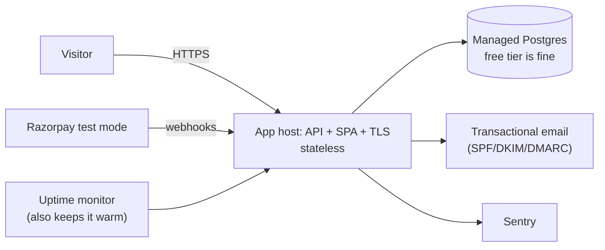

# Running SplitLedger Live as a Public Demo

**Status:** proposed · **Date:** 2026-10-15 · **Companion to:** `SPRINT_PLAN.md`, `CICD_DOCKER_CLOUD.md`

> **Decision (2026-10-15):** SplitLedger ships as a **publicly reachable demo**. Anyone can sign
> up and use it; settlement runs through **Razorpay test mode**; **no real money moves anywhere in
> the product.** This replaces the earlier draft of this document, which planned a real-user
> service settling through UPI intent links.

This is a coherent and sensible target, and it is cheaper and safer than the alternative. It is
still *live* — real people, real signups, real sessions, a URL that must be up when someone clicks
it from your CV. What it is not is a custodian of anyone's financial relationships.

---

## 1. What "live demo" means, precisely

| | Real | Simulated |
|---|---|---|
| Accounts, emails, sessions | **Real people signing up** | |
| Groups, expenses, splits, ledger, balances | Real arithmetic, correctly stored | The *amounts* are whatever people type to try it out |
| Razorpay checkout and webhooks | Real API calls, real signature verification, real idempotency | **No money moves.** Test mode only |
| Uptime | A URL that must work when a recruiter clicks it | |

Two consequences, and they point in opposite directions:

- **Data safety relaxes.** Nobody's rent depends on this. A lost day of demo data is embarrassing,
  not harmful. That removes the single most expensive requirement from the previous plan.
- **Honesty tightens.** Real people are signing up with real email addresses, and some of them
  will type real numbers before reading anything. The product must say what it is, everywhere,
  unmissably.

---

## 2. The risk this inverts: UPI intent is now the dangerous feature

Counter-intuitive, and worth being deliberate about.

**Razorpay test mode cannot move money.** That is the point of it. It is the *safe* payment path.

**A UPI intent link can.** `upi://pay?pa=<vpa>&am=<amount>` opens the payer's real UPI app with a
real payee and a real amount. If someone puts a genuine VPA in their profile and another user taps
"pay" against a made-up ₹4,000 test expense, **real money leaves a real bank account** to settle a
debt that was never real. You would not be in the flow, you would not know, and you could not
reverse it.

So in a demo product the honest configuration is the opposite of the one I proposed last time:

| Method | In the live demo | Why |
|---|---|---|
| `RAZORPAY` (test) | **On** — the headline feature | Cannot move money; demonstrates orders, signatures, webhooks, idempotency |
| `SANDBOX` | **On** | Auto-confirms; the fastest path for someone just looking around |
| `CASH` | **On** | Pure ledger bookkeeping, no payment rail at all |
| `UPI_INTENT` | **Off** (`PAYMENTS_UPI_INTENT_ENABLED=false`) | The only method that can touch real money. Keep the adapter, its tests and the interview answer; do not expose it on an instance where the data is fake |

If you later decide you want real settlement between real users, flipping that flag is the whole
change. The architecture does not move — that is what the `PaymentProvider` port bought you.

---

## 3. Make "this is a demo" unmissable

This is the one requirement that *replaces* the heavy data-protection work, and it is mostly
front-end effort. People will arrive without context.

| | Requirement |
|---|---|
| D1 | A persistent, non-dismissible banner: **"Demo — Razorpay test mode. No real money moves. Data may be reset."** On every page, not just payment screens |
| D2 | At signup, above the button: *"This is a portfolio demo. Please don't enter real financial information."* |
| D3 | A "Test mode" badge on every payment surface, already specified in `SPRINT_PLAN.md` SL-605 |
| D4 | **Razorpay's published test instrument details shown right in the checkout screen.** Nobody memorises test card numbers; without this, a visitor hits the gateway, has nothing to type, and leaves. Take the current values from Razorpay's test-mode documentation and render them next to the Pay button, copyable |
| D5 | The result screen says "simulated payment — no funds were transferred", not "payment successful" |

D4 is the difference between a demo someone completes and a demo someone abandons. It is one of
the highest-value small items in the whole project.

---

## 4. The highest-value feature you haven't planned: a guest tour

An empty app is a bad demo. A recruiter who signs up, verifies an email, creates a group, adds a
member who doesn't exist and stares at a zero balance has learned nothing about your ledger.

So: **one button on the landing page — "Explore the demo" — that logs the visitor into a seeded
account** with three members, a dozen expenses across all four split types, a non-trivial balance
graph, a confirmed Razorpay test settlement in the history, and an activity feed with something in
it. No signup, no email, no empty state. They see the simplification algorithm doing something
interesting within five seconds.

Reseed that account nightly so it survives being poked at. Leave real signups alone — do **not**
reset accounts people created, even in a demo; that is the kind of small rudeness that makes a
project feel abandoned.

This single feature does more for the portfolio value of the project than Sprint 7's entire k6
report, and it is about two points of work.

---

## 5. Architecture: barely changes

| Decision | Rationale |
|---|---|
| **Managed Postgres, free tier** | Still off the app host, because a stateless app host is what makes recovery a redeploy. But PITR and paid retention are no longer needed — a nightly dump is proportionate to disposable data |
| **Drop Redpanda from the live runtime** | Unchanged from before: keep the outbox table and the publisher interface, run the in-process `LocalEventBus` in the deployed app, keep the Kafka adapter tested in CI. The design claim stays true and demonstrable |
| **Redis optional** | One instance means Bucket4j and the balance cache work in-process. Add managed Redis only if you run two |
| **Going live makes Sprint 6 easier** | The webhook endpoint finally has a stable public HTTPS URL, so you can register it in the Razorpay test dashboard and stop tunnelling. Consider deploying *before* Sprint 6 rather than after |

---

## 6. Hosting and honest cost

> Verify current pricing and free-tier terms before committing; they change often.

The data-safety pressure is gone, so free tiers are genuinely viable. One thing still argues for
spending a little: **cold starts**. Most free app tiers spin down after inactivity, and a recruiter
who waits 45 seconds on a white screen closes the tab. That is the failure mode that actually costs
you something here.

Two workable options:

- **~₹0:** free app host + free managed Postgres, with your **uptime monitor pinging
  `/api/v1/health-check` every 10 minutes** to keep the instance warm. The monitor you want anyway
  doubles as the keep-alive. Watch for free Postgres tiers that *pause* a project after a week of
  no traffic — the same ping habit prevents that.
- **~$5–7/month (recommended):** one small always-on app instance, free Postgres, free email and
  monitoring tiers, plus ~$10–15/year for a domain. Removes cold starts as a category of problem.
  For a link that lives on your CV for years, this is worth it.

Set a billing alarm at 3× whatever you pick, use a fixed instance size, and never enable
autoscaling.

**Host choice:** keep the EC2 + Docker Compose + Caddy deployment from Sprint 8 — it is a real
skill and a good interview answer, and with disposable data the consequences of a VM going sideways
are mild. If you would rather not patch an OS at all, a PaaS removes that work and the deployment
story is still yours to describe. Either is defensible now; with real financial data it would not
have been.

---

## 7. What this removes from the launch list

Compared with a real-user service, most of the heavy work falls away. Retained items are retained
for a specific reason, not out of caution.

| Still required | Why it survives a demo posture |
|---|---|
| **Email verification** | Not negotiable, and it is a security hole rather than a nicety: invites are addressed to an email address, so without verification anyone can register an address they don't control and read that group's members and balances. Demo data is still other people's data |
| **Transactional email with SPF/DKIM/DMARC** | Verification and invite mails are the only way the app works at all. Unauthenticated mail lands in Gmail's spam folder and the product looks broken for reasons you will never see |
| **Privacy policy, terms, contact address** | You are collecting real names and real email addresses. That is personal data regardless of how fake the expenses are. Keep the policy short and say the data may be reset |
| **Account deletion** | Same reason. Anonymise the user row, keep the postings so other members' balances stay consistent |
| **Rate limits on invite and email paths** | Your sending reputation is a shared resource; one abuser burns it for everyone |
| **Per-account caps + a registration kill switch** | Bounds abuse and your bill |
| **Uptime monitor + Sentry** | Low stakes but high value: "my CV link is down" matters, and it costs nothing |

| Dropped or downgraded | Reason |
|---|---|
| PITR, paid backup retention, rehearsed restores | Disposable data. A nightly dump is enough |
| CSV export | Nobody needs to extract fake expenses. Backlog |
| Leave-group | Nice to have. Backlog |
| A separate demo environment | **The demo *is* production.** The original `CICD §8` conclusion — one environment, no staging — is correct again |
| Wind-down obligations | Nobody depends on the data, so taking it offline harms no one. Still worth a line in the terms |

Net effect: the two launch sprints collapse into one (`SPRINT_PLAN.md §12`), and the project
lands at roughly **10 weeks** instead of 11.

---

## 8. Operations you can sustain

### Alert on almost nothing
Quiet hours on everything. Nothing here justifies waking you.

| Condition | Why |
|---|---|
| Health check failing > 15 minutes | Your CV link is down |
| `ledger_reconciliation_drift != 0` | The arithmetic is wrong. This is the one that matters, because correctness *is* the thesis of the project — a demo that computes balances incorrectly is worse than no demo |
| Error rate > 5% over 15 minutes | Something shipped broken |
| Monthly spend > 2× budget | Cost runaway |

### Weekly, 15 minutes
Uptime incidents · Sentry triage · drift still zero · merge green Dependabot PRs · glance at signups.

### Monthly
Check the bill · apply base-image updates · confirm the nightly dump actually ran and can be read ·
confirm the guest-tour account still reseeds and still looks good.

### Deploy rules
Migrations stay forward-only and backward-compatible (`CICD §9`), automatic rollback on a failed
smoke test stays, and anything risky goes behind a flag. Don't deploy right before you go offline.

---

## 9. Data responsibility, proportionate version

You hold real names and real email addresses. The expense data is fiction, the identities are not.

- **Collect less.** Email, display name, password hash. No phone, no address, no date of birth.
  Make the VPA field optional, or remove it entirely now that UPI intent is off.
- **Publish a short privacy policy and terms:** what you store, why, that it may be reset, how to
  get it deleted, and a real contact address.
- **Honour deletion** without a database console.
- **Never log credentials, tokens, signatures or full webhook payloads.**
- India's DPDP Act 2023 still applies to the personal data you do hold. This is not legal advice;
  the practical mitigation is holding very little, which you already do.

---

## 10. What this changes in the plan

| Change | Detail |
|---|---|
| S9 and S10 collapse into **one Sprint 9 — Public demo launch** (13 pts) | `SPRINT_PLAN.md §12` |
| Razorpay test mode is promoted | From demo-only flag to **the live settlement method** |
| `UPI_INTENT` is demoted | Built and tested, **disabled in the deployed instance** (§2) |
| New work | Demo framing (D1–D5) and the guest tour (§4) |
| Dropped from launch | PITR and rehearsed restores, CSV export, leave-group, the separate demo environment |
| Availability target | ~99% monthly, best effort, no HA claim. Recovery is "redeploy the stateless app"; data loss up to the last nightly dump is accepted and stated |
| Sequence (applied) | S0–S5 product → **S6 deploy with registration off** → S7 Razorpay, now against a real webhook URL → S8 events/cache/perf → S9 open it to the public. Deployment moved five sprints earlier; see `SPRINT_PLAN.md §1` item 7 |

That last row is the one worth acting on, and it is now the plan: with no real-money risk and
disposable data there is no reason to keep the app on a laptop until week nine. The kill switch
(`REGISTRATION_ENABLED=false`) is what makes going up early safe — the app is reachable, you are
the only account, and the signup hole that email verification closes is simply not exposed yet.

Decisions behind all of this are recorded in [`adr/`](adr/README.md); ADR-013 is the one that
governs this document.
