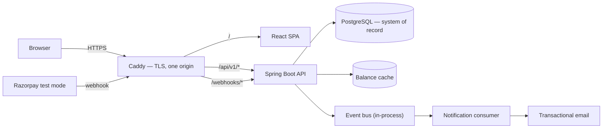
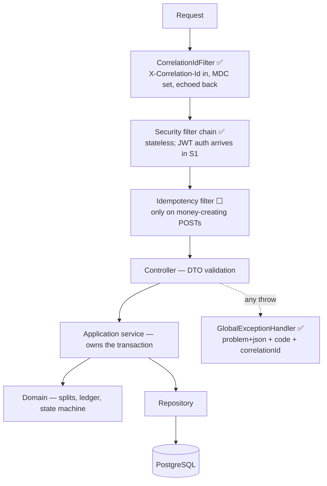
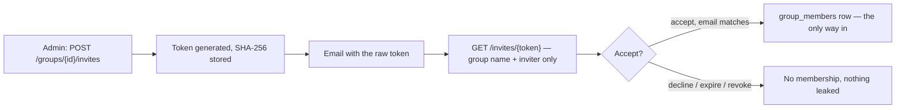
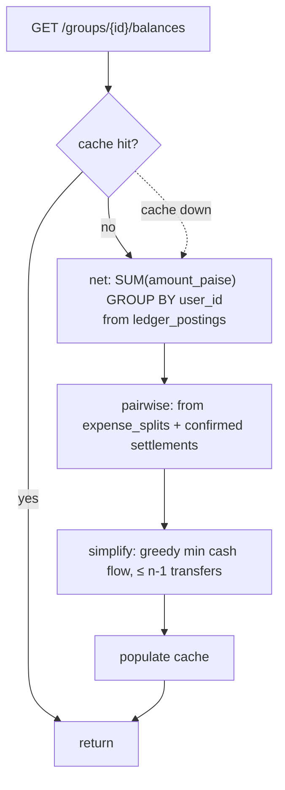
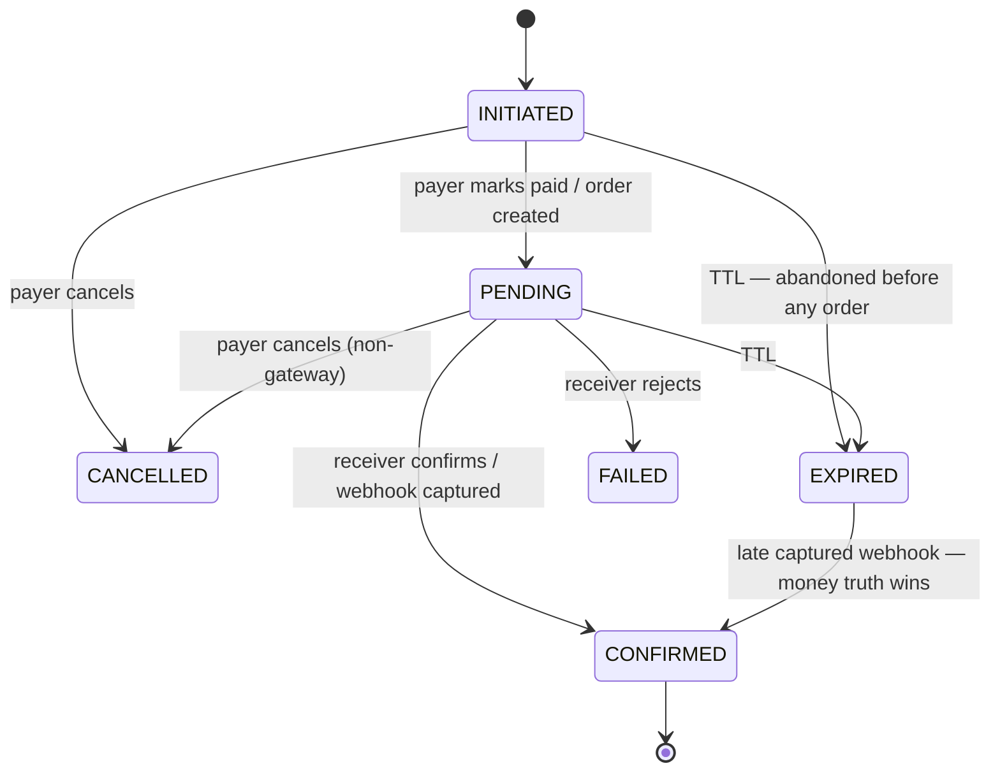
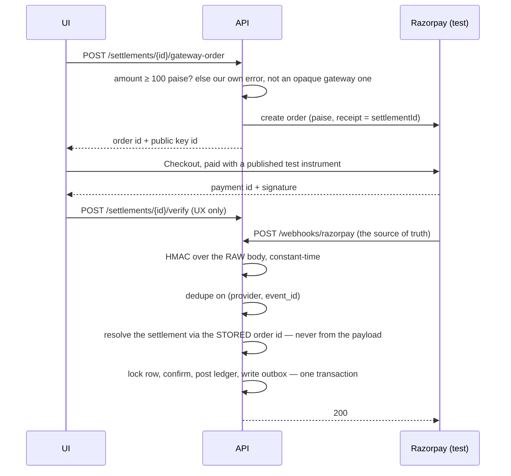
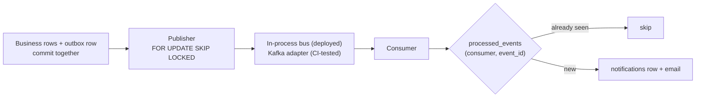
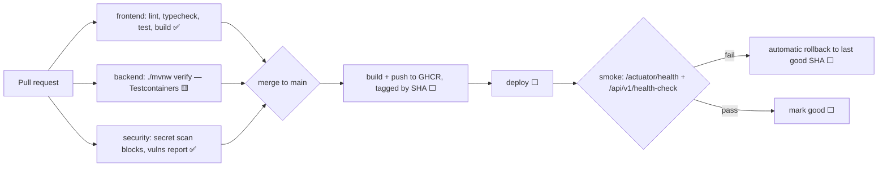

# Application Flow

How a request becomes a balance change, end to end. The HLD says *what* the parts are and the LLD
says *how* each is built; this document follows the path through them.

**Status markers** — this doubles as a build tracker:
✅ implemented and tested · 🟨 partly built · ⬜ designed, not built

---

## 1. The shape of it



Everything shares **one origin**. That is not cosmetic: it is what lets the refresh token be a
`SameSite=Strict` cookie and removes CSRF from every other endpoint (ADR-011), and it is why the
SPA calls relative `/api/v1` paths with no base-URL environment variable.

---

## 2. Request lifecycle ✅

Every API call passes through the same chain. Added in SL-005.



Two rules ArchUnit enforces rather than documents: a controller never touches a repository, and the
transaction boundary is the application service — never the controller, never the domain.

The correlation id is cleared in a `finally` block. Containers reuse threads, and a stale id is
worse than no id.

---

## 3. Identity ⬜ *(Sprint 1, plus verification in Sprint 9)*

```mermaid
sequenceDiagram
  participant UI
  participant API
  participant DB
  participant MAIL

  UI->>API: POST /auth/register
  API->>API: BCrypt(10) hash
  API->>DB: insert user (unverified)
  API->>MAIL: verification token (hashed in DB, single use, 24h)
  UI->>API: GET /invites/{token} — cannot accept until verified
  UI->>API: POST /auth/login
  API-->>UI: access token (15 min, body) + refresh cookie (7d, httpOnly, Strict, /auth/refresh)
  Note over UI: access token held in memory only — never localStorage
  UI->>API: any call → 401
  UI->>API: POST /auth/refresh (withCredentials)
  API->>DB: look up SHA-256 of presented token
  alt token already used
    API->>DB: revoke the whole chain
    API-->>UI: 401 — reuse means it leaked
  else valid
    API->>DB: rotate; store new hash
    API-->>UI: new access token + new cookie
  end
```

**Why verification gates invite acceptance:** invites are addressed to an email. Without
verification, anyone could register an address they do not control and read that group's members
and balances. That is a real hole, not a nicety — which is why it blocks opening registration
(SL-901, and `REGISTRATION_ENABLED=false` until then).

There is no access-token denylist. Logout revokes the refresh chain, so a stolen access token
lives at most 15 minutes — an accepted trade-off, not an oversight.

---

## 4. Groups and invites ⬜ *(Sprint 2)*



`GroupAccessGuard` runs at every group-scoped service entry point and returns **404, not 403**, for
groups the caller is not in — a 403 would confirm that the group exists.

---

## 5. Adding an expense ⬜ *(Sprint 3 — the heart of the system)*

```mermaid
sequenceDiagram
  participant UI
  participant API
  participant DB

  UI->>API: POST /groups/{id}/expenses + Idempotency-Key
  API->>DB: insert IN_PROGRESS marker (REQUIRES_NEW, committed at once)
  Note over API,DB: separate transaction, or a concurrent duplicate<br/>could never observe it
  API->>DB: BEGIN
  API->>DB: SELECT ... FROM expense_groups WHERE id=? FOR UPDATE
  Note over API,DB: serialises this group only; other groups run in parallel
  API->>API: validate payer + every participant is an ACTIVE member
  API->>API: allocate splits — largest remainder, exact sum
  API->>DB: insert expense + expense_splits
  API->>DB: insert ledger_transaction + postings (sum = 0)
  API->>DB: insert outbox_events row
  API->>DB: COMMIT
  API->>API: evict balance cache (afterCommit, never before)
  API->>DB: mark idempotency key COMPLETED, store response
  API-->>UI: 201
```

Five invariants, each with a test that fails if it breaks:

1. **Allocations sum exactly to the total.** Largest remainder with a deterministic tie-break.
2. **Postings sum to zero.** Payer `+total`, each participant `−owed`.
3. **One transaction per fact.** `UNIQUE (type, source_id)` makes double-posting impossible in the
   database, not merely unlikely in the code.
4. **Business rows and the outbox row commit together.** No phantom events, no lost events.
5. **Cache eviction happens after commit.** Evicting earlier can repopulate from an uncommitted
   read.

Editing and voiding never mutate. Void inserts a reversal with opposite signs; edit is
void-plus-create linked by `replaces_expense_id`, both under an `If-Match` version check.

---

## 6. Reading balances ⬜ *(Sprint 4)*



Two derivations on purpose. **Net** comes from the ledger and is the authorisation model. **Pairwise**
comes from the source tables and is the display model — "you owe Rahul ₹300". A nightly job
recomputes both and exports `ledger_reconciliation_drift`, which must always be zero; it is the one
metric that pages at any hour.

A cache outage degrades to the database. It never fails a request, which is exactly why idempotency
records live in PostgreSQL and not there (ADR-007).

---

## 7. Settling up, without a gateway ⬜ *(Sprint 5)*



The limit on a settlement is the **net** balance, not the pairwise debt:

```
require net[from] < 0 < net[to]
limit = min(-net[from], net[to])
```

This is ADR-010, and it is the fix for a contradiction that would otherwise have broken debt
simplification: a simplified transfer is deliberately a payment between two people with **no direct
debt** (A owes B, B owes C, so A pays C). Validating pairwise would have rejected every suggestion
the app makes. The same check re-runs at confirm time, which is what stops two pending settlements
for one debt from both completing.

Cash and sandbox only. `UPI_INTENT` is built and tested but **disabled in the deployed instance**:
a `upi://pay` link opens a real UPI app against a real payee, so it is the one method that could
move real money against fictional data (ADR-013).

---

## 8. Settling up through Razorpay test mode ⬜ *(Sprint 7)*



Four things that make this safe, and each is a deliberate choice:

- **The webhook is authoritative**; the browser callback only improves perceived latency. Both call
  the same idempotent `confirm` use case.
- **Signature over raw bytes**, verified before anything is parsed. Re-serialising JSON changes
  bytes and breaks the HMAC.
- **The settlement is found by stored `gateway_order_id`**, never by an id in the request body. A
  forged payload cannot select someone else's settlement.
- **Failures return 5xx on purpose** so Razorpay retries — safe, because processing is idempotent.
  Twenty parallel identical deliveries produce exactly one ledger transaction.

No real money moves. Test mode cannot move money; that is the point of using it.

---

## 9. Events and notifications ⬜ *(Sprint 8)*



Delivery is **at-least-once**, so consumers are idempotent by construction — a design constraint,
not an afterthought. The publisher is `@Profile("!consumer")` so the two runtime roles sharing one
image do not both poll.

The deployed instance runs the in-process bus and keeps the Kafka adapter under test (ADR-015). The
guarantees live in the outbox table and `processed_events`, not in the broker, so dropping the
broker costs nothing a user can observe.

---

## 10. Errors ✅

Every failure leaves as RFC 7807 `application/problem+json`:

```json
{
  "type": "https://splitledger.dev/errors/settlement-exceeds-outstanding",
  "title": "Paying more than the balance allows",
  "status": 422,
  "code": "SETTLEMENT_EXCEEDS_OUTSTANDING",
  "detail": "Limit is 30000 paise",
  "correlationId": "c0a8…"
}
```

`code` is the contract — clients branch on it, so renaming one is a breaking change. Unexpected
exceptions log the cause and return a generic `INTERNAL_ERROR`: the message may contain internals
and never reaches the client. The `correlationId` means a user can quote one string and we can find
the request.

---

## 11. Commit to production 🟨 *(pipeline built, deployment is Sprint 6)*



Images are immutable and SHA-tagged, so rollback is redeploying a known-good tag rather than
restoring anything. Migrations are forward-only and backward-compatible — add, backfill, then
remove in a later release — because an app rollback must never meet a schema it cannot read.

---

## 12. What actually runs today

| Flow | State |
|---|---|
| Request lifecycle: correlation id, security chain, problem+json | ✅ built, 12 unit tests passing |
| `GET /api/v1/health-check` | ✅ built |
| Frontend shell calling the API and rendering the result | ✅ built, typecheck/lint/test/build green |
| `V1__init.sql` — full schema | 🟨 written, **not yet run against a real PostgreSQL** |
| Nine ArchUnit boundary rules | ✅ enforced in CI and locally |
| CI pipeline | 🟨 written and validated; has never run, as there is no remote yet |
| Identity, groups, expenses, ledger, balances, settlements, events | ⬜ designed — Sprints 1–8 |

The honest summary: the plumbing a request travels through is real and tested. Nothing that touches
money exists yet.
